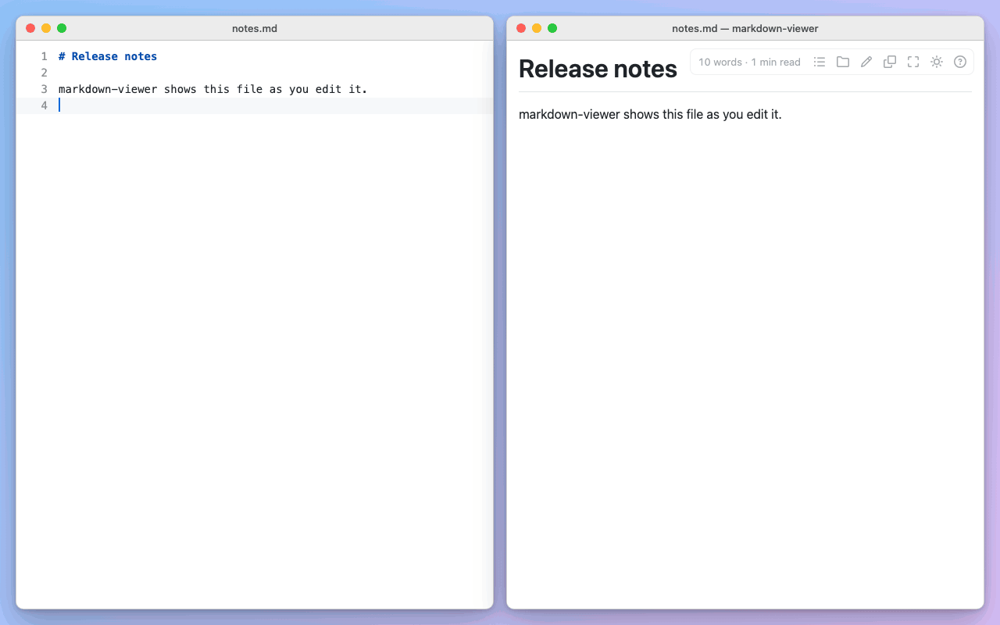
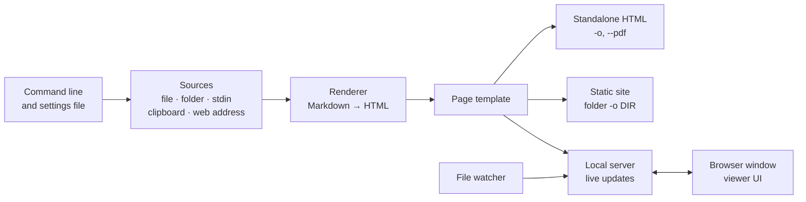

# markdown-viewer

Render a Markdown file with GitHub styling and view it in your browser, with
live reload while you edit. A small, fast, offline alternative to
[grip](https://github.com/joeyespo/grip) and Marked 2.

<p align="center">
  
  <br>
  <em>GitHub styling with alerts, Mermaid diagrams, math and highlighted code.</em>
</p>

<br>

<p align="center">
  
  <br>
  <em>Edit in your editor; the page updates every time you save.</em>
</p>

## Quickstart

```sh
markdown-viewer --watch README.md
markdown-viewer                     # browse the current folder
```

For a tour of every feature, run:

```sh
markdown-viewer --watch examples/example.md
```

Or open the tour straight from GitHub, with no clone needed (any Markdown
address works, as do GitHub and GitLab file and repository pages):

```sh
markdown-viewer https://github.com/mdellavo/markdown-viewer/blob/main/examples/example.md
```

## Install

With Homebrew (macOS and Linux), including shell completions and a man page:

```sh
brew install mdellavo/tap/markdown-viewer
```

Debian, Ubuntu and Fedora packages (x86_64 and ARM64) are attached to each
[release](https://github.com/mdellavo/markdown-viewer/releases):

```sh
sudo apt install ./markdown-viewer_*_amd64.deb      # Debian, Ubuntu
sudo dnf install ./markdown-viewer-*.x86_64.rpm     # Fedora, RHEL
```

On Windows, with [Scoop](https://scoop.sh) (x64 and ARM64):

```powershell
scoop bucket add mdellavo https://github.com/mdellavo/scoop-bucket
scoop install mdellavo/markdown-viewer
```

or download `markdown-viewer-x86_64-pc-windows-msvc.zip` from a
[release](https://github.com/mdellavo/markdown-viewer/releases) and put
`markdown-viewer.exe` on your `PATH`. The zip includes PowerShell
completions (`completions\_markdown-viewer.ps1`; dot-source it from your
`$PROFILE`).

On Arch Linux, from the AUR (prebuilt, x86_64 and ARM64):

```sh
yay -S markdown-viewer-bin    # or paru, or makepkg by hand
```

With Rust's tools (the crate is `markdown-viewer-rs`; the command is still
`markdown-viewer`):

```sh
cargo binstall markdown-viewer-rs    # prebuilt binary
cargo install markdown-viewer-rs     # build from source (see Building)
```

## Features

**Rendering**

- GitHub's look, in light, dark, or following your OS setting. Switch any
  time with <kbd>t</kbd>.
- Built-in styles: `github` (default), `wide` (full window width), `book`
  (serif type, for long reading) and `compact`. Add your own CSS with `--css`:
  change fonts, colours (for light and dark) and the printed page (see
  [Custom CSS](#custom-css)).
- GitHub Flavored Markdown:
  - Headings with link anchors (hover a heading for its link icon).
  - Bold, italic and strikethrough.
  - Tables with column alignment. In the viewer, click a column header to
    sort by it (numbers as numbers); click again to reverse, and a third
    time for the file's order.
  - Task lists. When watching, tick a box to update the file: the `[ ]`
    in the Markdown becomes `[x]`.
  - Autolinked URLs and email addresses.
  - Footnotes.
  - Emoji shortcodes such as `:rocket:`.
- GitHub alerts, with GitHub's icons: `> [!NOTE]`, `[!TIP]`, `[!IMPORTANT]`,
  `[!WARNING]` and `[!CAUTION]`.
- Syntax highlighting for fenced code blocks, done when the page is built
  (no JavaScript), with copy and wrap buttons on each block.
- Code block extras, set after the language (GitHub ignores them):
  ```` ```rust title="main.rs" {3-5} showLineNumbers ```` adds a file-name
  title, highlights lines 3 to 5 and numbers the lines. `--line-numbers`
  numbers every block.
- A `[TOC]` line, or `<!-- TOC -->`, becomes a table of contents built from
  the headings (`<!-- TOC max2 -->` for two levels). Click its title to fold
  it, or a section's arrow to fold that section; folds stay as you left them
  while the file changes, and everything opens for printing.
- Theme-aware images: `#gh-light-mode-only` and `#gh-dark-mode-only` image
  URLs show only in that theme, as on GitHub.
- Math, typeset with [KaTeX](https://katex.org/):
  - Inline `$…$` and `` $`…`$ ``.
  - Display `$$…$$` and ```` ```math ```` blocks.
  - Invalid TeX is shown in red rather than breaking the page.
  - Dollar amounts like "$5 or $10" are left alone.
- [Mermaid](https://mermaid.js.org/) diagrams in ```` ```mermaid ```` blocks.
  All diagram types are supported: flowchart, sequence, class, state,
  entity-relationship, Gantt, pie, git graph, mindmap, timeline and more. A
  diagram with errors stays visible as source, with the error on hover.
- Maps and 3D models, from the same code blocks GitHub draws:
  - ```` ```geojson ```` and ```` ```topojson ```` blocks become maps:
    points, lines and areas over a latitude and longitude grid, with each
    feature's properties on hover, and GitHub's style properties (`stroke`,
    `fill`, `marker-color` and so on). Click a map to enlarge it. GitHub
    draws them on map tiles from the web; here they stay offline, without
    tiles.
  - ```` ```stl ```` blocks (ASCII STL) become shaded 3D models. Drag one to
    turn it, and double-click to go back.
  - Beyond GitHub: ```` ```gpx ```` (GPS tracks), ```` ```kml ```` and
    ```` ```wkt ```` blocks become maps too, and ```` ```obj ````,
    ```` ```ply ````, ```` ```off ```` and ```` ```gltf ```` blocks models.
  - Model and map files shown as images are drawn the same way:
    `` (binary STL too), `.obj`, `.ply`, `.off`, `.gltf`,
    `.glb`, `.3mf`, `.gpx`, `.kml`, `.geojson`, `.topojson` and `.wkt`, when
    the image is alone in its paragraph. glTF and 3MF models show their
    shape; materials and textures are left out.
  - All are drawn when the page is built, so they're in exports and PDFs
    too. A block that can't be drawn shows its source and the reason.
- More diagrams, also drawn when the page is built (offline, in exports
  too; click one to enlarge it):
  - ```` ```bob ````: ASCII-art diagrams, by
    [Svgbob](https://github.com/ivanceras/svgbob).
  - ```` ```pikchr ````: [Pikchr](https://pikchr.org), the diagram language
    from SQLite.
  - ```` ```wavedrom ````: [WaveDrom](https://wavedrom.com) timing
    diagrams (signals, buses with labels, groups, gaps; not arrows).
  - ```` ```dot ```` (or `graphviz`), ```` ```plantuml ```` and
    ```` ```d2 ````: drawn by [Graphviz](https://graphviz.org),
    [PlantUML](https://plantuml.com) or [D2](https://d2lang.com) when the
    program is installed (otherwise the block says what to install).
    PlantUML runs in its sandbox mode, which can't read other files or the
    web.
  - ```` ```qr ````: the block's text as a QR code.
  - ```` ```fen ```` and ```` ```pgn ````: chess boards, for a position or
    a game's final position (moves are checked, and the last one is
    marked).
- Charts, sheet music and molecules, drawn in the page by bundled
  libraries (loaded only on pages that use them):
  - ```` ```vega-lite ```` (and ```` ```vega ````):
    [Vega-Lite](https://vega.github.io/vega-lite/) charts. Data can be in
    the block, or a JSON file next to the document when serving.
  - ```` ```abc ````: sheet music in [ABC notation](https://abcnotation.com),
    by [abcjs](https://www.abcjs.net/).
  - ```` ```smiles ````: chemical structures from SMILES, by
    [SmilesDrawer](https://github.com/reymond-group/smilesDrawer).
- Molecules: ```` ```mol ````/```` ```sdf ```` (molfiles), ```` ```xyz ```` and
  ```` ```pdb ```` blocks, or those files shown as images. A flat molfile is
  drawn as a structure diagram (bonds, double bonds, wedges, labels with
  their hydrogens and charges); 3D coordinates as balls and sticks that turn
  when dragged, with bonds the file leaves out found by distance.
- Calendars: an ```` ```ics ```` block or `` lists the events
  by month, with times and time zones, places, descriptions and how they
  repeat.
- [AsciiMath](https://asciimath.org) in ```` ```asciimath ```` blocks (one
  equation per line), typeset by KaTeX.
- Video and audio linked like images (``, `.webm`, `.mov`,
  `.mp3`, `.ogg`, `.wav`, …) become players, as on GitHub and in Obsidian.
- Colours in inline code (`` `#0969da` ``, `` `rgb(…)` ``, `` `hsl(…)` ``)
  get a swatch after them, as on GitHub.
- Beyond GitHub:
  - Definition lists: a term, then lines starting with `: `.
  - `^superscript^` and `~subscript~`. (On GitHub, single tildes strike
    through; here only `~~double~~` does.)
  - Abbreviations: `*[HTML]: HyperText Markup Language` anywhere in the
    file shows that meaning when you hover over "HTML". The definition
    lines themselves don't appear.
- Raw HTML, as READMEs often use it: centered images, `<details>`, `<kbd>`,
  `<sub>`/`<sup>`.
- YAML front matter shown as a table, as on GitHub (or hidden with
  `--front-matter hide`).
- Numbered headings (1, 1.1, 1.2, …) with `--number-headings`, in the page
  and the contents.
- Obsidian notes, on automatically inside a vault (a `.obsidian` folder;
  try [`examples/vault`](examples/vault/Home.md)):
  - `[[wiki links]]`, including `[[Note|label]]` and `[[Note#Heading]]`,
    found by name anywhere in the vault. Missing notes are marked.
  - `![[image.png]]` embeds (with an optional width, `![[image.png|300]]`).
  - `![[Note]]` shows the note inline, and `![[Note#Heading]]` just that
    section.
  - A **Backlinks** tab listing the notes that link to this one (it also
    works outside a vault, for ordinary Markdown links).
  - Callouts (`> [!tip] Title`), including folded ones (`> [!faq]-`).
  - `==highlights==`, with `%%comments%%` hidden.
  - `#tags` in the text (nested ones too, `#projects/garden`) shown as
    chips.
- Tags: front matter `tags:` (on any page) and Obsidian `#tags` are shown
  as chips. When serving, a **Tags** tab (<kbd>#</kbd>) lists every tag in
  the folder with the files using each, this page's tags first; click a
  chip to open its tag there.

- CSV and TSV files are shown as tables, as on GitHub: open one directly,
  or from a folder listing. Columns of numbers are right-aligned, and
  columns sort like any table.
- GitHub references, as GitHub links them: `#123` and `GH-123` (issues and
  pull requests), `owner/repo#123`, `@user` and commit hashes. The
  repository comes from the folder's git remote (GitHub or GitHub
  Enterprise), or the `github_repo` setting. Text in code and links is left
  alone.

**Viewing**

- Opens as a minimal app window (no tabs or address bar), a new window, or a
  tab, in your default browser or the one you choose (see
  [Opening the page](#opening-the-page)).
- Quick to show: the page's text appears before diagram and chart
  libraries load; diagrams on screen are drawn first, and drawings are
  remembered by the browser, so reloading or coming back shows them at
  once. When serving, the first page is rendered while the browser opens,
  and unchanged code blocks and drawings aren't redone on each save (nor
  is a page whose file was saved without changes). Opening a file starts
  the browser before the page is rendered, so the window comes up in about
  50 ms whatever the file's size, with a "Rendering…" note until a large
  page is ready.
- Steady while it loads: diagrams and math the browser remembers are in
  place before the page first shows, local images keep their space before
  they load (their size is read from the file: PNG, GIF, JPEG, WebP, AVIF,
  HEIC and SVG) and load only as you near them, and on long pages the
  parts off screen aren't laid out until you scroll near them. Saves reach the
  page in about 40 ms, and moving between pages fades instead of
  flashing.
- A file committed to git says at the foot of its page when it last
  changed and by whom, with an **Edit** link when its remote is on GitHub,
  GitLab, Bitbucket, Codeberg or Gitea (`last_updated = false` in the
  settings file turns this off).
- Watch mode (`--watch`) updates the page whenever you save:
  - It scrolls to the first thing you changed and briefly highlights it.
    Otherwise your scroll position is kept.
  - Diagrams and math are drawn before the update is shown, so nothing
    flickers.
  - Works with editors that save by replacing the file.
- Folder mode: `markdown-viewer some/folder` (or no argument, for the
  current folder) shows the folder's README, or a list of its files. Every
  Markdown file you open from there updates live too.
- A sidebar with the document's contents, which follows your place as you
  scroll, and, when serving, the folder's Markdown and CSV files as a tree,
  like an editor's file explorer: click a folder to open or close it (the
  current file's folders start open), and filter by name or search the
  files' text.
- View the Markdown source (<kbd>v</kbd>, or the toolbar's code button):
  syntax highlighted, with line numbers, kept up to date as the file
  changes. Switching keeps your place in both directions, and
  double-clicking a line opens it in your editor. It works for web
  addresses, standard input and the clipboard too (without the editor,
  as there's no file to open). It opens at once with the plain source and
  highlights it in the background, so long files stay quick;
  `source_highlighting = false` keeps it plain.
- Double-click a paragraph (or press <kbd>e</kbd>) to open the source in your
  editor at that line (see [Editor](#editor)). The other way round,
  `markdown-viewer --goto file.md:42` scrolls the preview to a line; the
  [Zed and VS Code integrations](editors/) use it to follow your cursor.
- Reopening a file takes you back to where you were reading.
- Recent files: `markdown-viewer --recent`, or `markdown-viewer` with no
  arguments in your home folder, lists the files and folders you opened
  lately, newest first and grouped by when, each a click away. They're
  also in the sidebar's **Recent** tab (<kbd>h</kbd>) on every page. Remove
  one with its × button. Files outside the folder being viewed open in a
  viewer of their own.
- Opening a file that's already being viewed brings its window to the front
  instead of opening another.
- Click an image or diagram to zoom; scroll to zoom further and drag to pan.
- Presentation mode (<kbd>s</kbd>): the document as full-screen slides,
  split at `---` rules (or at headings, if there are none). Try
  [`examples/slides.md`](examples/slides.md).
- Open Markdown from the web: `markdown-viewer https://…/notes.md`. GitHub
  and GitLab file pages and repository addresses work too (a repository
  shows its README). Relative links and images point back at the web, and
  the page re-fetches every 10 seconds while open. Needs `curl`.
- Preview standard input (`markdown-viewer -`) or the clipboard
  (`--clipboard`; with `--watch` the page follows the clipboard as it
  changes).
- Larger or smaller text (<kbd>+</kbd> / <kbd>-</kbd>), remembered between
  runs.
- Show what changed since the last git commit (<kbd>D</kbd>): changed blocks
  get a bar in the margin, like an editor's gutter.
- Blame (<kbd>B</kbd>): rest the pointer on a paragraph to see who last
  changed it, when, and the commit (linked on GitHub, GitLab, Bitbucket,
  Codeberg and Gitea), from `git blame`, including changes not committed
  yet.
- A rendered diff: `markdown-viewer notes.md --diff HEAD~3` shows the page
  with what changed since that git revision marked: added words in green,
  removed words struck through in red, and changed code blocks, diagrams
  and maps shown old and new. A summary at the top counts the words. It
  follows the file as you save, and works with `-o` and `--pdf` too. Use
  `--diff HEAD` for uncommitted changes, or a branch, tag or commit.
- Copy the whole page (<kbd>c</kbd>): rich text for Docs, Slack or email, with
  the Markdown as plain text.
- Check the page's links (<kbd>l</kbd>), or every file's with
  `--check-links` (see [Checking links](#checking-links)).
- Large files stay fast: an edit updates only the blocks that changed.
- Word count and reading time in the toolbar; <kbd>w</kbd> (or a click on
  it) hides it to save space, and it stays hidden until you show it again.
  `word_count = false` in the settings file hides it by default.
- Back, forward and reload buttons in the toolbar, since app windows have
  no browser controls.
- Links to web pages, and to files the viewer doesn't show as pages (images,
  PDFs and so on), open in a new browser window, so the document stays put.
  Links between Markdown and CSV files, and within the page, stay in the
  window.
- Keyboard shortcuts for everything (see [In the viewer](#in-the-viewer)).
- Your theme and sidebar choices are remembered between runs.
- In watch mode, relative images load, and links to other `.md` files open as
  rendered pages.
- Ctrl-C stops watch mode and closes the window it opened.

**Exporting**

- `-o` writes a single self-contained HTML file (or `-o -` for stdout), with
  any diagrams and math included.
- For a folder, `-o site/` writes a static site: a page for every Markdown
  file, with links between them working, an index for every folder (its
  README or a listing), the images they use, and the viewer UI with a Files
  sidebar. Put it on GitHub Pages or any web server, or open it straight
  from disk.
- `--pdf` writes a PDF using Chrome, Chromium, Edge, Brave or Vivaldi, with
  diagrams and math rendered, in light colours, and without page breaks
  inside code blocks, tables or diagrams.
- Printing from the browser uses the same print layout.

**Finder (macOS)**

- A "Markdown Viewer" app for Markdown files: Open With, double-click (once
  set as the default), or drop files on its icon. See
  [Finder integration](#finder-integration-macos).
- An "Open in Markdown Viewer" Quick Action in Finder's right-click menu.
- Each file opens in its own live-reloading window, and the viewer exits
  when you close the window.

**Linux desktops**

- A "Markdown Viewer" application for Markdown, CSV and TSV files: Open With
  in your file manager, or the default if you choose. The `.deb`, `.rpm` and
  AUR packages include it; otherwise `--install-desktop` adds it (see
  [Linux desktop integration](#linux-desktop-integration)).

**Offline and safe**

- Everything ships inside one binary: stylesheets, fonts, KaTeX, mermaid.js,
  Vega-Lite, abcjs and SmilesDrawer. Pages never contact the network, though
  images that link to the web still load. The libraries are only added to
  pages that use them.
- Scripts inside the Markdown are blocked (see [Security](#security)).

## Usage

```sh
markdown-viewer README.md                # render once and open in your browser
markdown-viewer --watch README.md        # live-reload as the file changes
markdown-viewer README.md -o out.html    # write the HTML to a file
markdown-viewer README.md -o - | less    # ...or to stdout
markdown-viewer README.md --pdf out.pdf  # write a PDF
markdown-viewer docs/ -o site/           # write a folder as a static site
markdown-viewer docs/                    # browse a folder (live)
git show HEAD~1:README.md | markdown-viewer -   # preview standard input
markdown-viewer --clipboard --watch      # follow the clipboard as it changes
markdown-viewer --check-links docs/      # report broken links (exit status 1)
markdown-viewer --lint docs/             # report writing problems (exit status 1)
markdown-viewer data.csv                 # a CSV or TSV file as a table
markdown-viewer https://github.com/o/r   # a repository's README, or any Markdown URL
markdown-viewer --recent                 # files and folders you opened lately
markdown-viewer notes.md --diff HEAD~3   # what changed since a git revision
markdown-viewer --goto README.md:42      # scroll a running preview to line 42
markdown-viewer --version                # version, commit and build details
```

| Option | Description |
|---|---|
| `-w`, `--watch` | Serve on `127.0.0.1` and reload the page when the file changes |
| `-o`, `--output <PATH>` | Write HTML to `PATH` (`-` for stdout) instead of opening it; for a folder, a static site into the folder `PATH` |
| `--pdf <PATH>` | Write a PDF to `PATH` (needs a Chromium-based browser) |
| `-p`, `--port <N>` | Port for `--watch` (default: any free port) |
| `--browser <NAME>` | Open a specific browser, e.g. `"Google Chrome"` or `firefox` |
| `--app` | Open as a minimal app window with no tabs or address bar (default) |
| `--window` | Open in a normal new browser window |
| `--tab` | Open in a tab of an existing window |
| `--no-open` | Don't open a browser |
| `--theme <auto\|light\|dark>` | Colour theme (default: the one you last chose, else auto) |
| `--style <github\|wide\|book\|compact>` | Page style (default: `github`) |
| `--css <PATH>` | Extra CSS file, applied after the built-in styles |
| `--number-headings` | Number headings (1, 1.1, 1.2, …) |
| `--front-matter <table\|hide>` | Show YAML front matter as a table (default) or hide it |
| `--obsidian`, `--no-obsidian` | Force Obsidian notes on or off (default: on inside a vault) |
| `--editor <COMMAND>` | Editor for double-click-to-source (see [Editor](#editor)) |
| `--clipboard` | Preview the clipboard instead of a file |
| `--line-numbers` | Number the lines of every code block |
| `--goto <FILE:LINE>` | Scroll a running viewer to a line, or open one there |
| `--if-running` | With `--goto`: do nothing if no viewer is showing the file |
| `--check-links` | Check the links in a file or folder and report broken ones |
| `--online` | With `--check-links`: also check web links (needs `curl`) |
| `--lint` | Report writing problems in a file or folder (see [Linting](#linting)) |
| `--diff <REV>` | Show the file with what changed since a git revision marked: added text in green, removed text struck through in red |
| `--recent` | Show the files and folders you opened recently |
| `--keep-running` | With `--watch`: keep serving after the window is closed (until Ctrl-C) |
| `--exit-when-closed` | With `--watch`: exit once the page has been closed for 5 seconds, even with `--no-open` (the default otherwise) |
| `--install-finder` | macOS: add the Finder integration for your user |
| `--uninstall-finder` | macOS: remove the Finder integration |
| `--install-desktop` | Linux: add the desktop integration for your user |
| `--uninstall-desktop` | Linux: remove the desktop integration |

Every page you open is served by a viewer, so live reload, settings and
everything marked "when serving" below always work:

- **Without `--watch`,** the viewer runs in the background: the command
  returns as soon as the page is open, and the viewer stops by itself once
  the window has been closed for 5 seconds (or if no window connects within
  a minute). Its messages go to `viewer.log` next to the state file.
- **With `--watch`,** it stays in the foreground of your terminal until the
  window closes or you press Ctrl-C (see [Opening the page](#opening-the-page)).
- **With `--no-open`** and no `--watch`, nothing is served: the page is
  written to your temp directory as a standalone file, and its path printed.

Giving a folder (or nothing) serves it with live reload, except that with
nothing in your home folder you get the Recent page instead of all of your
home folder. Exported pages (`-o`, static sites, `--pdf`) have no viewer
behind them.

### In the viewer

The toolbar in the top-right corner starts with back, forward and reload
buttons (app windows have no browser controls), shows the word count and
reading time, and has buttons for the contents, the file list (when
serving), editing the source, presenting, the theme and help. Hovering a
code block shows its copy button.

| Key | Action |
|---|---|
| <kbd>[</kbd> / <kbd>]</kbd> | Back / forward (<kbd>Alt</kbd>-<kbd>←</kbd> / <kbd>Alt</kbd>-<kbd>→</kbd> work too) |
| <kbd>r</kbd> | Reload |
| <kbd>t</kbd> | Switch theme: auto, light, dark |
| <kbd>o</kbd> | Show or hide the contents |
| <kbd>f</kbd> | Find a file (when serving): type to filter, Enter to open |
| <kbd>/</kbd> | Search the text of every file (when serving) |
| <kbd>e</kbd> | Open the source in your editor here (or double-click a paragraph) |
| <kbd>s</kbd> | Present as slides: arrows or space to move, <kbd>Esc</kbd> to stop |
| <kbd>+</kbd> / <kbd>-</kbd> / <kbd>0</kbd> | Larger / smaller / normal text |
| <kbd>c</kbd> | Copy the page |
| <kbd>b</kbd> | Backlinks: other files that link here (when serving) |
| <kbd>#</kbd> | Tags: every tag in the folder and the files using it (when serving) |
| <kbd>h</kbd> | Recent files, in the sidebar (when serving) |
| <kbd>l</kbd> | Check this page's links (when serving) |
| <kbd>D</kbd> | Show what changed since the last git commit (when serving) |
| <kbd>B</kbd> | Blame: rest the pointer on a paragraph to see who last changed it (when serving) |
| <kbd>j</kbd> / <kbd>k</kbd> | Scroll down / up |
| <kbd>d</kbd> / <kbd>u</kbd> | Half a page down / up |
| <kbd>g</kbd> / <kbd>G</kbd> | Top / bottom |
| <kbd>n</kbd> / <kbd>p</kbd> | Next / previous heading |
| <kbd>v</kbd> | View the Markdown source, syntax highlighted with line numbers (when serving); <kbd>v</kbd> again goes back, at the same place |
| <kbd>w</kbd> | Show or hide the word count and reading time |
| <kbd>,</kbd> | Settings: change and save the [settings file](#settings-file) (when serving) |
| <kbd>?</kbd> | Show the shortcuts, and About: the version and build, bundled Mermaid and KaTeX, and (when serving) where the settings and state files are, the editor in use and the served folder. **Copy details** copies it all, for bug reports. Then credits for the projects markdown-viewer is built on |
| <kbd>Esc</kbd> | Close |

The theme, whether the sidebar is open, and where you were in each file are
remembered for next time. `--theme` overrides the remembered theme for that
run. Pages opened without `--watch` remember them in the browser instead.

### Editor

Double-clicking a paragraph, or pressing <kbd>e</kbd>, opens the file in
your editor at that line (when serving). The editor is the first of:

1. `--editor`, or `editor` in the settings file, e.g. `"zed"` or
   `"code -g {file}:{line}"`.
2. `$MARKDOWN_VIEWER_EDITOR`.
3. `$VISUAL` or `$EDITOR`, if it's a known graphical editor.
4. The first one found of Zed, VS Code, Cursor, Windsurf, VSCodium, Sublime
   Text, TextMate or IntelliJ IDEA (or Notepad++, if you name it).
5. On macOS, the default text editor; on Windows, Notepad (neither jumps to
   the line).

Terminal editors such as vim can't be used, as there's no terminal to run
them in.

### Settings file

Put defaults for any of these options in
`~/.config/markdown-viewer/config.toml` (or `$XDG_CONFIG_HOME/markdown-viewer/config.toml`;
on Windows, `%APPDATA%\markdown-viewer\config.toml`).
Command-line options override it, and a theme you pick in the viewer
overrides its `theme`.

You can also change settings in the viewer: press <kbd>,</kbd> or the gear
in the toolbar. Each change is saved to this file straight away (its
comments and layout are kept) and applies at once: rendering options update
the page, the style and custom CSS reload it, and the browser, open mode,
port and Obsidian mode are used the next time a page opens. A change the file wouldn't
accept, such as a CSS file that doesn't exist, isn't saved. Command-line
options still win for the current run, and the dialog says when one does.

```toml
theme = "auto"          # auto, light or dark
style = "book"          # github, wide, book or compact
css = "~/notes.css"     # extra stylesheet
open = "window"         # app, window or tab
browser = "Firefox"
port = 6419
editor = "zed"          # or "code -g {file}:{line}"
front_matter = "table"  # table or hide
number_headings = true
line_numbers = true     # number every code block
obsidian = false        # default: on inside an Obsidian vault
github_references = false   # default: on in a checkout with a GitHub remote
github_repo = "owner/repo"  # if it isn't found from the git remote
lint_ignore = ["multiple-h1", "duplicate-heading"]   # --lint rules to skip
recent = false          # don't remember opened files for the Recent page
word_count = false      # hide the word count and reading time (w toggles it)
exit_when_closed = false  # keep serving after the window closes (until Ctrl-C)
source_highlighting = false  # show the source view (v) without highlighting
last_updated = false    # no "Last updated … / Edit" footer
```

Unknown keys are reported as errors, so typos don't go unnoticed. Set
`MARKDOWN_VIEWER_CONFIG` to use a different file.

### Opening the page

By default the page opens as a minimal app window, with no tabs, address bar
or toolbar, so the preview can sit next to your editor. It uses your default
browser, or the one given with `--browser`. On Windows, `--browser` takes
a name (`chrome`, `edge`, `brave`, `vivaldi`, `firefox`) or a path to the
browser's `.exe`.

| Browser | Default (`--app`) | `--window` |
|---|---|---|
| Chrome, Edge, Brave, Chromium, Vivaldi | app window | new window |
| Firefox, Opera, Safari | new window (no app mode) | new window |
| Others | new tab | new tab |

Closing the window (or tab) markdown-viewer opened also stops it: once no
page has been open for 5 seconds, the server shuts down and the command
exits, so nothing is left running. The pause lets a reload, or moving to
another file in a folder, carry on. Use `--keep-running` (or
`exit_when_closed = false` in the settings file) to keep serving until
Ctrl-C. With `--no-open` it always keeps running.

When you stop `--watch` with Ctrl-C, a window that markdown-viewer opened
closes itself. Some pages stay open instead, showing a "markdown-viewer
stopped" banner:

- A tab, whether from `--tab` or a page you opened yourself.
- A window you've used to visit another page.

The window size is up to the browser. Chrome ignores size requests when it's
already running.

### Finder integration (macOS)

```sh
markdown-viewer --install-finder
```

This adds two things for your user only, with no admin rights needed:

- `~/Applications/Markdown Viewer.app`, which you can use to open Markdown
  files:
  - **Open With:** right-click a `.md` file > Open With > Markdown Viewer.
  - **Double-click:** to make it the default, use Get Info on a `.md` file >
    Open with > Markdown Viewer > Change All….
  - **Drag and drop:** drop files on the app's icon.
  - **Launched on its own:** it asks you to choose a file.
- A right-click > Quick Actions > **Open in Markdown Viewer** menu item. It
  doesn't change which app opens `.md` files. If it's missing, turn it on in
  Finder's right-click > Quick Actions > Customize…, or in System Settings >
  Keyboard > Keyboard Shortcuts > Services.

Each file opens with `--watch --exit-when-closed`, so it updates as you edit
and quits by itself when you close its window. Output goes to
`~/Library/Logs/markdown-viewer.log`.

The app runs the `markdown-viewer` you installed it from. For Homebrew that's
the stable `bin` link, so upgrades keep working. Remove it with
`markdown-viewer --uninstall-finder`.

### Custom CSS

```sh
markdown-viewer --css examples/custom.css README.md
```

A stylesheet given with `--css` (or `css = "…"` in the settings file) goes
after the built-in styles, in the viewer, exports, static sites and PDFs.
Colours are GitHub's CSS variables, so one line changes them everywhere:

```css
.markdown-body { --fgColor-accent: #9a4a12; }   /* links */
```

[Writing custom CSS](docs/custom-css.md) explains the page's structure, the
variables, light and dark colours, print styles and limits, with recipes.
[`examples/custom.css`](examples/custom.css) is a complete theme to start
from.

### Linux desktop integration

The `.deb`, `.rpm` and AUR packages install a "Markdown Viewer" application
for everyone. Otherwise (Homebrew, a tarball or `cargo install`), add it
for your user:

```sh
markdown-viewer --install-desktop
```

This writes `~/.local/share/applications/markdown-viewer.desktop` and its
icon. Markdown, CSV and TSV files then offer Markdown Viewer under **Open
With** in your file manager. To open Markdown files with it by default:

```sh
xdg-mime default markdown-viewer.desktop text/markdown
```

Each file opens with `--watch --exit-when-closed`, so it updates as you edit
and quits by itself when you close its window. The entry runs the
`markdown-viewer` you installed it from (for Homebrew, the stable `bin`
link). Remove it with `markdown-viewer --uninstall-desktop`.

### Checking links

```sh
markdown-viewer --check-links README.md          # one file
markdown-viewer --check-links docs/              # every Markdown file in a folder
markdown-viewer --check-links docs/ --online     # also request web links
```

It reports each broken link as `file:line: target (reason)` and exits with
status 1 if there are any, so it works in CI. It checks relative files and
images, `#anchors` (in the same file or another one), and wiki links in an
Obsidian vault. Web links are only checked with `--online`, which uses
`curl`.

### Linting

```sh
markdown-viewer --lint README.md                 # one file
markdown-viewer --lint docs/                     # every Markdown file in a folder
markdown-viewer --lint --check-links docs/       # both at once
```

Like `--check-links`, it reports `file:line: problem (rule)` and exits with
status 1 if there are any. The rules:

| Rule | Checks that |
| --- | --- |
| `heading-increment` | heading levels go down one at a time (no `#` then `###`) |
| `multiple-h1` | there's one top-level (`#`) heading |
| `duplicate-heading` | no two headings under the same heading have the same text (the second's link would end in `-1`) |
| `image-alt` | images have alt text, for screen readers |
| `empty-link` | links have text and a target |
| `code-language` | fenced code blocks say their language, for highlighting |

Skip rules with `lint_ignore` in the [settings file](#settings-file).

### Editors

`markdown-viewer --goto file.md:42` scrolls a running viewer to line 42, or
opens one there. Zed tasks and a VS Code extension that use it are in
[`editors/`](editors/): a key to show the cursor's line in Zed, and
following the cursor in VS Code.

## Building

You need Rust 1.91 or newer. Install it with [rustup](https://rustup.rs/), or
run `rustup update` to upgrade. No other tools or system libraries are needed:
the stylesheets, fonts, icons, KaTeX and mermaid.js are built into the binary.
On Windows, rustup also needs Visual Studio's C++ build tools (it offers to
install them).

```sh
git clone https://github.com/mdellavo/markdown-viewer
cd markdown-viewer
cargo build --release
```

The binary is `target/release/markdown-viewer`. To put it on your `PATH`
(in `~/.cargo/bin`):

```sh
cargo install --path .
```

To run it straight from the source tree without installing:

```sh
cargo run -- --watch examples/example.md
```

### Packages

Release packages are built by `packaging/package.sh` (`packaging/package.ps1`
on Windows), the scripts the release workflow uses. Build for a target first, then package it. The output
goes to `dist/`, with a `.sha256` checksum next to each file.

```sh
target=$(rustc -vV | sed -n 's/^host: //p')    # e.g. aarch64-apple-darwin
cargo build --release --locked --target "$target"
packaging/package.sh "$target"
```

This always makes `markdown-viewer-<target>.tar.gz`, which holds the binary,
README, LICENSE, CHANGELOG, shell completions and man page. On Linux it also
makes a `.deb` and an `.rpm`, which need two more tools:

```sh
cargo install cargo-deb cargo-generate-rpm
```

Their contents are set in `Cargo.toml`, under `[package.metadata.deb]` and
`[package.metadata.generate-rpm]`. To check a `.deb`:

```sh
sudo dpkg -i dist/markdown-viewer_*.deb && markdown-viewer --version
```

On Windows, build and package from PowerShell; this makes
`dist\markdown-viewer-<target>.zip` with its checksum:

```powershell
cargo build --release --locked --target x86_64-pc-windows-msvc
pwsh packaging/package.ps1 x86_64-pc-windows-msvc
```

The Homebrew formula, the AUR package and the Scoop manifest download a
published GitHub release, so they're generated from that release's
checksums:

```sh
v=0.5.0
gh release download v$v --pattern '*.sha256' --dir /tmp/sums

# Homebrew: the formula for mdellavo/homebrew-tap
packaging/homebrew/formula.sh $v /tmp/sums > markdown-viewer.rb

# Scoop: the manifest for mdellavo/scoop-bucket
packaging/scoop/manifest.sh $v /tmp/sums > markdown-viewer.json

# AUR: PKGBUILD and .SRCINFO for markdown-viewer-bin, then build and
# install it in an Arch Linux container to check it (needs Docker)
packaging/aur/pkgbuild.sh $v /tmp/sums dist/aur
docker run --rm -v "$PWD/dist/aur:/pkg:ro" -v "$PWD/packaging/aur/test.sh:/test.sh:ro" \
  archlinux:latest bash /test.sh /pkg
```

For crates.io, `cargo package --locked` builds and checks the crate that
`cargo publish` would upload. It needs everything committed; add
`--allow-dirty` to try it with uncommitted changes.

### Development

```sh
cargo test                                  # unit, end-to-end and browser tests
cargo clippy --all-targets -- -D warnings   # lints, as CI runs them
cargo fmt                                   # format
```

The browser tests drive the viewer in headless Chrome. They're skipped if no
Chrome-family browser is installed, except in CI, where they must run.

The shell completions (`completions/`) and man page (`man/`) are generated
from the command-line options, and a test fails if they're out of date.
Regenerate them with:

```sh
UPDATE_GENERATED=1 cargo test --test cli generated_files
```

If a change alters rendered output on purpose, the snapshot test fails.
Review and accept the new snapshot with
[cargo-insta](https://insta.rs/docs/cli/) (`cargo install cargo-insta`):

```sh
cargo insta review
```

The screenshots and the demo at the top of this README are generated, and
are refreshed for each release (needs Chrome, and ffmpeg for the demo):

```sh
cargo build && docs/screenshots.sh && docs/demo.sh
```

Releases are built by GitHub Actions when a `v*` tag is pushed; see
[AGENTS.md](AGENTS.md#releasing).

## Architecture

markdown-viewer is a single Rust binary. Everything a page needs is compiled
into it: GitHub's stylesheet, the viewer's scripts, Mermaid, KaTeX and its
fonts, Vega-Lite, abcjs, SmilesDrawer, and the icons. It never fetches anything from the internet unless
you ask it to (web addresses, `--check-links --online`); only images and
media that a document itself links to are loaded from the web.



**Rendering.** [comrak](https://github.com/kivikakk/comrak) parses GitHub
Flavored Markdown, and [syntect](https://github.com/trishume/syntect)
highlights code when the page is built. A series of small passes then
brings the HTML closer to GitHub and adds the extras: alert icons, heading
anchors, front matter tables, code block titles and line numbers, the table
of contents, GitHub references, and Obsidian wiki links, embeds and
callouts. Maps, 3D models and most diagrams (Svgbob, Pikchr, WaveDrom,
chess, QR codes, and Graphviz, PlantUML or D2 when installed) are drawn as
SVG at this point, so they need no script. Mermaid diagrams, math, Vega-Lite
charts, sheet music and molecules are drawn in the browser by their
libraries.
CSV and TSV files skip Markdown and become tables directly.

**The page.** One template produces every page. It carries all the themes
at once (switched by an attribute on `<html>`), the print layout, any custom
CSS, and a strict Content Security Policy: only the page's own scripts, each
with a nonce, can run. On top sits the viewer UI (`ui.js`): toolbar, contents
and files sidebar, settings, help, source view, presentation mode and
keyboard shortcuts.

**Outputs.** The same rendered page goes to one of four places:

- a self-contained HTML file, with the libraries inlined (`-o`);
- a PDF, printed by a headless Chrome-family browser (`--pdf`);
- a static site, one page per file with links rewritten (`-o` for a
  folder);
- a local web server, which is how pages are normally viewed.

**Live viewing.** The server ([axum](https://github.com/tokio-rs/axum))
listens only on `127.0.0.1`. It watches the folders of the documents being
viewed and re-renders a file when it changes. Pages stay connected through
Server-Sent Events. An update sends the page's blocks, and `live.js` swaps
in only the ones that changed, so scroll position, folds and sorting
survive and long files stay fast. The same connection lets the server know
when the window has closed.

**Lifetime.** Opening a file without `--watch` starts the server as a
background process and returns at once. The server stops a few seconds after
its last window closes. `--watch` runs it in the foreground instead, until
its window closes or you press Ctrl-C (`--keep-running` waits for Ctrl-C
only). A small registry of running viewers, kept next to the state file,
lets a second launch for the same file bring the existing window forward,
and lets `--goto` from an editor find it.

**Talking back.** A few actions go from the page to the server: ticking a
task box, opening the editor at a line, saving preferences and settings,
and checking links. Those that change anything need a header only the
viewer's own scripts send, so other web pages can't trigger them. The
server never serves files outside its root: the document's folder (or its
Obsidian vault), the folder you gave it, or your home folder for the Recent
page.

**Settings and state.** The settings file (TOML) holds your defaults, and
the settings dialog edits it in place, keeping your comments. Viewer
preferences (theme, sidebar, text size, git marks, word count, reading
positions, recent files)
live in a separate JSON state file.

**Platforms.** OS-specific code is kept in a few modules: finding and opening
the browser (as an app window where it can), opening editors, file paths and
detaching background processes, for macOS, Linux and Windows. The Finder
app and the Linux desktop entry are thin launchers for the same command.

## Security

- **Raw HTML:** allowed, because READMEs often use it. The page's
  Content-Security-Policy blocks any script that comes from the Markdown,
  and a `<base>` tag that would change where the page's own scripts load
  from. KaTeX and Mermaid run in their strict modes, and Vega-Lite charts
  evaluate their expressions without `eval`.
- **Files shown as images:** a model, map, molecule or calendar file shown
  as an image is read when the page is built (only by its relative path, at
  most 20 MB), and its drawing is put in the page, so exports and static
  sites include it.
- **Diagram programs:** Graphviz, PlantUML and D2 blocks run that program
  (if installed) on the block's text, in an empty temporary folder, with a
  time limit; PlantUML in its sandbox mode (no other files, no web). Their
  SVG is put in the page without scripts or event handlers.
- **Watch server:** listens on loopback only and serves only files inside
  the Markdown file's folder (or the folder you gave it). The file list
  skips hidden folders and doesn't follow symlinked folders. Other files
  from the folder, such as HTML pages and SVG images, are served
  sandboxed, so their scripts can't use the viewer.
- **Other websites:** requests addressed to any other hostname are rejected,
  so a website can't read the files being served. Saving preferences also
  needs a custom header, which other websites can't send to it.
- **Settings dialog:** only the viewer's own pages can change settings:
  saving needs the same custom header other websites can't send. The
  `editor` setting is a command that runs when you double-click, so treat
  it like the rest of the settings file.
- **About:** pages carry only the build (version, commit, target). Local
  details (file paths, the editor) come from the viewer when serving, so
  exported pages and static sites never include them.
- **Editor and reading positions:** the page can ask the server to open a
  file in your editor or to remember a position, but only for Markdown files
  inside the served folder, and only with a custom header other websites
  can't send. The editor runs without a shell.
- **Ticking task boxes:** the one way the page changes your files. The
  server only changes a `[ ]` or `[x]` in a Markdown file inside the served
  folder, only if that line still holds a task item in the state the page
  showed, and only with the same custom header. If the file is open in an
  editor with unsaved changes, the editor will see it changed on disk.
- **Web addresses:** fetched with `curl`. Their pages are served from an
  empty folder of their own, so nothing on your disk is reachable from
  them; their scripts are blocked like any page's; and they can't be
  edited or have their task boxes ticked.
- **Static sites:** `-o DIR` only writes into an empty folder or one an
  earlier export wrote, and only copies files inside the exported folder
  that a page links to.
- **Recent files:** the list stays on your computer, in the state file
  next to your reading positions. The Recent page is served from your home
  folder, the same as browsing it would be. A page can ask the viewer to
  open a recent item outside its folder, but only one that's in the list,
  and only with the custom header other websites can't send. Set
  `recent = false` to stop recording.
- **GitHub references:** only change links on the page; nothing is fetched
  from GitHub.
- **PDF export:** runs the browser headless with a throwaway profile, so it
  never touches your own browser profile.

## Todo

> [!NOTE]
> These are ideas, not promises: not all of them will be implemented, and
> any that are may end up working differently. The viewer stays a viewer, so
> editing features are out of scope.

**Navigating a vault or folder**

- [ ] Quick switcher: <kbd>Ctrl</kbd>/<kbd>⌘</kbd>-<kbd>O</kbd> for a fuzzy
  finder over file names, headings and aliases.
- [ ] Command palette (<kbd>⌘</kbd>/<kbd>Ctrl</kbd>-<kbd>K</kbd>): one
  search over files, headings and viewer commands.
- [ ] Hover previews of linked notes and headings, and of footnotes, and
  tooltips showing where a web link goes.
- [ ] Graph view: how notes link, for the whole folder or this note's
  neighbours, and a heatmap of the most linked notes.
- [ ] Unlinked mentions: notes that name this one without linking to it.
- [ ] Bookmarks for notes, headings and searches, as a sidebar tab.
- [ ] A sticky breadcrumb of the headings you're under, while scrolling.
- [ ] Recently changed: the folder's files by modification time, as a
  sidebar tab.
- [ ] A calendar of daily notes (`2026-11-27.md`), and previous/next day
  links on them.
- [ ] Task overview: every open task across the folder, grouped by file,
  with ticking working there too.
- [ ] Task progress ("4 of 9 done") in the toolbar and on each list, and a
  key to hide finished items.
- [ ] A link health tab: broken links, orphan notes and missing anchors in
  the folder, from `--check-links`.
- [ ] Open a random note (Obsidian's "random note"), for rediscovering a
  vault.
- [ ] Reopen last session: the files you had open, at the same places.
- [ ] Note hierarchies from dotted names (`project.ideas.md`) shown as a
  tree, and placeholder notes for links to notes not written yet (as in
  Dendron and Foam).
- [ ] Search hits highlighted on the page a search result opens.
- [ ] Type to filter the Contents tab, for documents with many headings.
- [ ] Tags: nested tags (`#projects/garden`) as a tree in the Tags tab,
  tag search in the file finder (`#tag`), and the tag chips of a folder
  listing's files.

**Obsidian and plugin syntax**

- [ ] Block references: `^block-id` anchors, `[[Note#^id]]` links and
  `![[Note#^id]]` embeds.
- [ ] `aliases:` for wiki links, and typed display of properties (dates,
  links, lists, checkboxes).
- [ ] Read-only Dataview queries (```` ```dataview ```` tables and lists
  from the vault's front matter), and Obsidian Bases (`.base` files).
- [ ] Tasks plugin queries (```` ```tasks ````) and Obsidian search blocks
  (```` ```query ````), as lists of results.
- [ ] Kanban boards (the Kanban plugin's Markdown files), read-only.
- [ ] JSON Canvas: `.canvas` files as a pannable board.
- [ ] More embeds: `![[file.pdf]]` (with `#page=N`), `![[clip.mp4]]` and
  `![[song.mp3]]` as players, and `![[file.csv]]` and `![[part.stl]]`
  drawn as they are with ``.
- [ ] Excalidraw drawings (`.excalidraw`, `.excalidraw.md`).
- [ ] Flashcards: review `#card` notes and `Q::A` lines with spaced
  repetition, as in Logseq and Obsidian's plugins (only the review
  schedule is saved, not the notes).
- [ ] Fold nested list items (outliner style, as in Logseq), remembered
  per file.
- [ ] Inline footnotes (`^[a note right here]`) and `==highlights==`
  outside Obsidian mode too.
- [ ] Callout options: `> [!note|wide]` metadata and custom callout types
  from the vault's CSS snippets.

**Rendering**

- [ ] KaTeX macros (`\R`, `\vec` …) from front matter or the settings file.
- [ ] Includes: `<!-- include chapter2.md -->` to assemble long documents,
  with live updates following the included files.
- [ ] Custom processors: pipe the Markdown through a command (Pandoc, a
  preprocessor) before rendering.
- [ ] Image captions from the title (`` as a
  figure).
- [ ] Footnotes as sidenotes in the margin, when the window is wide enough.
- [ ] A ```` ```chart ```` block over a table or CSV file, drawn offline.
- [ ] Chemistry in math: `$\ce{H2O + CO2 -> H2CO3}$`, with KaTeX's mhchem
  extension.
- [ ] Inline AsciiMath in running text (not only blocks), and V3000
  molfiles.
- [ ] 3D models with their colours and materials (glTF, 3MF, OBJ with
  `.mtl`), and molecules as ribbons for proteins.
- [ ] Maps with an offline base map (coastlines and borders bundled at low
  detail), so tracks and points have some context without web tiles.
- [ ] Redraw a page when a file it shows as an image changes (models, maps,
  molecules, calendars), not only when the Markdown is saved.
- [ ] Other Markdown dialects' extras: MkDocs admonitions (`!!! note`),
  content tabs (`=== "Linux"`), and Pandoc attributes on headings and
  images (`{#id .class width=50%}`).
- [ ] Citations: `[@doe2020]` from a `.bib` or CSL JSON file, with a
  bibliography at the end (as in Zettlr and Pandoc).
- [ ] Numbered figures, tables and equations, with cross-references
  (`@fig:map`), as pandoc-crossref does.
- [ ] CriticMarkup review marks (`{++added++}`, `{--removed--}`,
  `{>>comment<<}`), shown like the rendered diff.
- [ ] Page breaks for printing and PDFs (`<!-- pagebreak -->`).
- [ ] Code annotations: `# (1)` markers in code blocks that open a note,
  as in MkDocs Material.
- [ ] Collapsible code blocks (```` ```python fold ````) and tab sets, as in
  Quarto.
- [ ] GitLab's `[[_TOC_]]` table of contents marker.
- [ ] More themes: GitHub's dark dimmed and high-contrast variants, and a
  sepia reading theme.

**Other formats**

- [ ] Jupyter notebooks (`.ipynb`): Markdown cells, highlighted code and
  the saved outputs (text, tables, images, charts), without running
  anything.
- [ ] JSON, YAML and TOML files as foldable trees, in the file list like
  CSV tables.
- [ ] Other markup through Pandoc when it's installed: reStructuredText,
  Org and AsciiDoc files.
- [ ] Subtitles: a `clip.vtt` next to `clip.mp4` becomes the video's
  captions.
- [ ] Railroad (syntax) diagrams from EBNF, and bit-field / register
  layouts in WaveDrom's style.
- [ ] Mind maps from an ordinary Markdown list (```` ```markmap ````).
- [ ] Barcodes (Code 128, EAN-13), like the QR code blocks.
- [ ] Points from a CSV with latitude and longitude columns, on a map.
- [ ] Colour palettes (```` ```palette ````, `.gpl`, `.ase`) as named
  swatches, and font files (`.ttf`, `.otf`, `.woff2`) as a type specimen.
- [ ] Terminal recordings (asciinema `.cast`) shown as their last screen,
  or played back.
- [ ] MusicXML sheet music.
- [ ] More diagrams through installed programs, like Graphviz: TikZ (via
  LaTeX), Mscgen, blockdiag/seqdiag, Structurizr and draw.io files.
- [ ] Kroki diagram types through a Kroki server you run yourself (pages
  stay offline otherwise).
- [ ] Calendar times in your own time zone, and a month grid view.
- [ ] PDFs linked like images (``) shown in an embedded
  viewer.

**Git**

- [ ] A whole-repository diff: every changed Markdown file, each opening
  its rendered diff (`--diff` on a folder).
- [ ] Compare two files (`--diff-file other.md`) or two revisions.
- [ ] The file at any revision (`--rev v1.0`), and a History tab: the
  file's commits, each opening its rendered diff.
- [ ] Choose staged or unstaged changes for `--diff`.

**Reading**

- [ ] Focus mode: dim everything but the current paragraph or section,
  with a reading ruler.
- [ ] A reading progress bar and a heading minimap.
- [ ] Read aloud with the system's speech, highlighting each sentence.
- [ ] Reading width and font choices in the toolbar, remembered.
- [ ] Readability statistics: reading level, sentence length, longest
  paragraphs and overused words, each linked to its place.
- [ ] The headings as a zoomable mind map.
- [ ] Split view: two documents side by side, or the page and its source
  scrolling together.
- [ ] Speaker notes and a presenter view (timer, next slide) for
  presentation mode.
- [ ] Marp-style slide directives (`<!-- paginate: true -->`, a class or
  background per slide), slide themes, step-by-step reveals, and an
  overview grid of all slides.
- [ ] Keyword highlighting from a word list, and word-frequency and
  repetition reports (as in Marked 2).
- [ ] A word count target, with progress in the toolbar.
- [ ] Fold a section by clicking its heading in the page, remembered per
  file.
- [ ] Mark every block that changed on save, not only the first.
- [ ] Step through a page's images with the arrow keys once one is
  enlarged, as a gallery.
- [ ] A glossary of the page's abbreviations, and reading time for each
  section in the contents.
- [ ] Proofing: highlight doubled words, passive voice and your own list
  of words to watch for.

**Speed**

- [ ] Keep highlighted code and drawings on disk between runs (keyed by
  their text and the version), so a file's first page in a new viewer is
  as quick as a re-render (about 3 ms instead of 90–180 ms).
- [ ] Render the other files in a folder in the background, and fetch a
  linked page when the pointer rests on its link, so moving between
  files is instant.
- [ ] Very large files: render the visible part first, then the rest.
- [ ] Share drawn diagrams between windows and with exports: the page
  sends what Mermaid and the chart libraries drew back to the viewer,
  which keeps it for other pages, `-o` and static sites.
- [ ] Lighter exports: `-o` pages with diagrams drawn ahead of time as SVG
  (through a headless browser), so they don't carry 5 MB of Mermaid.
- [ ] Load the highlighter's grammars for the languages a folder uses in
  the background at startup.

**Working with an editor**

- [ ] Preview unsaved edits: the VS Code extension sends the buffer as you
  type.
- [ ] Scroll the editor from the preview (`--goto` in reverse).
- [ ] Neovim, Sublime Text and JetBrains integrations like the VS Code
  extension: open the preview, follow the cursor.

**Exporting**

- [ ] EPUB export, for a file or a folder, and DOCX through Pandoc when
  it's installed.
- [ ] PDF options: paper size, margins, page numbers, header and footer, a
  cover page from the front matter, and bookmarks from the headings.
- [ ] Slides to PDF, one slide per page, and to PowerPoint.
- [ ] A print-all page: a folder joined into one document, in the order
  of a `SUMMARY.md` (as in mdBook) or the file names, to print or save as
  one PDF.
- [ ] Export from the viewer: a toolbar menu for PDF, HTML or rich text.
- [ ] `-o` with local images, video and audio embedded too (today they're
  linked), so the page can be emailed as one attachment.
- [ ] Export to plain GitHub Markdown: wiki links, embeds and includes
  resolved, for publishing an Obsidian note elsewhere.
- [ ] Save a diagram, chart, map, model or math block as SVG or PNG.
- [ ] Copy a link to a heading or a block, from its link icon.
- [ ] Graph, tags and backlinks in `-o` static sites.
- [ ] Search in exported sites, from an index written at export time
  (working from disk too).
- [ ] `-o site/ --watch`: rebuild only the changed pages on save.
- [ ] Versioned sites: a version picker for docs exported from several git
  tags (as Docusaurus does).
- [ ] Site navigation: page order and titles from front matter,
  previous/next links and a `sitemap.xml`.

**Sharing and devices**

- [ ] `--host`: let other devices on your network view the page, protected
  by a token in the address, with a QR code in the terminal for phones.

**Platform and packaging**

- [ ] Quick Look on macOS: press space on a `.md` file in Finder, and a
  preview handler for Windows Explorer.
- [ ] A native window (WKWebView on macOS): real menus and a remembered
  window size, whatever your default browser is.
- [ ] Optionally gather pages as tabs in one window (`open = "tabs"`),
  keeping the tab-less app window as the default.
- [ ] A browser per file type or folder in the settings file, and a
  toolbar button to open the page in your everyday browser.
- [ ] The VS Code extension on the Marketplace and Open VSX.
- [ ] A Nix flake, a winget package, a Flatpak, and a Windows installer
  that registers `.md` files.
- [ ] A GitHub Action and a pre-commit hook for `--check-links` and
  `--lint`.
- [ ] An optional update check, off by default.
- [ ] A terminal mode (`--terminal`): read a file in the terminal, with
  paging, links and search (as Glow and Frogmouth do).
- [ ] A browser extension that renders `.md` files opened directly in the
  browser (`file://` and raw GitHub links) the same way.

## License

MIT. Includes:

- [github-markdown-css](https://github.com/sindresorhus/github-markdown-css)
  (MIT, see `assets/LICENSE-github-markdown-css`).
- [KaTeX](https://github.com/KaTeX/KaTeX) (MIT, see `assets/LICENSE-katex`).
- [Primer Octicons](https://github.com/primer/octicons) (MIT, see
  `assets/LICENSE-octicons`).
- [Mermaid](https://github.com/mermaid-js/mermaid) (MIT, see
  `assets/LICENSE-mermaid`).
- [Vega](https://github.com/vega/vega), [Vega-Lite](https://github.com/vega/vega-lite)
  and vega-interpreter (BSD-3-Clause, see `assets/libs/LICENSE-vega*`).
- [abcjs](https://github.com/paulrosen/abcjs) (MIT, see
  `assets/libs/LICENSE-abcjs`).
- [SmilesDrawer](https://github.com/reymond-group/smilesDrawer) (MIT, see
  `assets/libs/LICENSE-smiles-drawer`).
