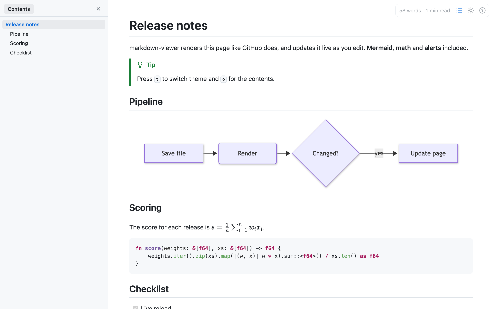

# markdown-viewer

Render a Markdown file with GitHub styling and view it in your browser, with
live reload while you edit. A small, fast, offline alternative to
[grip](https://github.com/joeyespo/grip) and Marked 2.

<picture>
  <source media="(prefers-color-scheme: dark)" srcset="docs/screenshot-dark.png">
  
</picture>

```sh
markdown-viewer --watch README.md
markdown-viewer                     # browse the current folder
```

For a tour of every feature, run:

```sh
markdown-viewer --watch examples/example.md
```

## Features

**Rendering**

- GitHub's look, in light, dark, or following your OS setting. Switch any
  time with <kbd>t</kbd>.
- Built-in styles: `github` (default), `wide` (full window width), `book`
  (serif type, for long reading) and `compact`. Add your own CSS with `--css`.
- GitHub Flavored Markdown:
  - Headings with link anchors (hover a heading for its link icon).
  - Bold, italic and strikethrough.
  - Tables with column alignment.
  - Task lists.
  - Autolinked URLs and email addresses.
  - Footnotes.
  - Emoji shortcodes such as `:rocket:`.
- GitHub alerts, with GitHub's icons: `> [!NOTE]`, `[!TIP]`, `[!IMPORTANT]`,
  `[!WARNING]` and `[!CAUTION]`.
- Syntax highlighting for fenced code blocks, done when the page is built
  (no JavaScript), with a copy button on each block.
- Theme-aware images: `#gh-light-mode-only` and `#gh-dark-mode-only` image
  URLs show only in that theme, as on GitHub.
- Math, typeset with [KaTeX](https://katex.org/):
  - Inline `$…$` and `` $`…`$ ``.
  - Display `$$…$$` and ```` ```math ```` blocks.
  - Invalid TeX is shown in red rather than breaking the page.
  - Dollar amounts like "$5 or $10" are left alone.
- [Mermaid](https://mermaid.js.org/) diagrams in ```` ```mermaid ```` blocks.
  All diagram types are supported: flowchart, sequence, class, state,
  entity-relationship, Gantt, pie, git graph, mindmap, timeline and more. A
  diagram with errors stays visible as source, with the error on hover.
- Raw HTML, as READMEs often use it: centered images, `<details>`, `<kbd>`,
  `<sub>`/`<sup>`.
- YAML front matter is hidden.

**Viewing**

- Opens as a minimal app window (no tabs or address bar), a new window, or a
  tab, in your default browser or the one you choose (see
  [Opening the page](#opening-the-page)).
- Watch mode (`--watch`) updates the page whenever you save:
  - It scrolls to the first thing you changed and briefly highlights it.
    Otherwise your scroll position is kept.
  - Diagrams and math are drawn before the update is shown, so nothing
    flickers.
  - Works with editors that save by replacing the file.
- Folder mode: `markdown-viewer some/folder` (or no argument, for the
  current folder) shows the folder's README, or a list of its files. Every
  Markdown file you open from there updates live too.
- A sidebar with the document's contents, which follows your place as you
  scroll, and, when serving, a list of the folder's Markdown files with a
  filter.
- Word count and reading time in the toolbar.
- Keyboard shortcuts for everything (see [In the viewer](#in-the-viewer)).
- Your theme and sidebar choices are remembered between runs.
- In watch mode, relative images load, and links to other `.md` files open as
  rendered pages.
- Ctrl-C stops watch mode and closes the window it opened.

**Exporting**

- `-o` writes a single self-contained HTML file (or `-o -` for stdout), with
  any diagrams and math included.
- `--pdf` writes a PDF using Chrome, Chromium, Edge, Brave or Vivaldi, with
  diagrams and math rendered, in light colours, and without page breaks
  inside code blocks, tables or diagrams.
- Printing from the browser uses the same print layout.

**Finder (macOS)**

- A "Markdown Viewer" app for Markdown files: Open With, double-click (once
  set as the default), or drop files on its icon. See
  [Finder integration](#finder-integration-macos).
- An "Open in Markdown Viewer" Quick Action in Finder's right-click menu.
- Each file opens in its own live-reloading window, and the viewer exits
  when you close the window.

**Offline and safe**

- Everything ships inside one binary: stylesheets, fonts, KaTeX and
  mermaid.js. Pages never contact the network, though images that link to
  the web still load. KaTeX and Mermaid are only added to pages that use them.
- Scripts inside the Markdown are blocked (see [Security](#security)).

## Install

With Homebrew (macOS and Linux):

```sh
brew install mdellavo/tap/markdown-viewer
```

From source (needs Rust, see [Building](#building)):

```sh
cargo install --git https://github.com/mdellavo/markdown-viewer
```

## Usage

```sh
markdown-viewer README.md                # render once and open in your browser
markdown-viewer --watch README.md        # live-reload as the file changes
markdown-viewer README.md -o out.html    # write the HTML to a file
markdown-viewer README.md -o - | less    # ...or to stdout
markdown-viewer README.md --pdf out.pdf  # write a PDF
markdown-viewer docs/                    # browse a folder (live)
```

| Option | Description |
|---|---|
| `-w`, `--watch` | Serve on `127.0.0.1` and reload the page when the file changes |
| `-o`, `--output <PATH>` | Write HTML to `PATH` (`-` for stdout) instead of opening it |
| `--pdf <PATH>` | Write a PDF to `PATH` (needs a Chromium-based browser) |
| `-p`, `--port <N>` | Port for `--watch` (default: any free port) |
| `--browser <NAME>` | Open a specific browser, e.g. `"Google Chrome"` or `firefox` |
| `--app` | Open as a minimal app window with no tabs or address bar (default) |
| `--window` | Open in a normal new browser window |
| `--tab` | Open in a tab of an existing window |
| `--no-open` | Don't open a browser |
| `--theme <auto\|light\|dark>` | Colour theme (default: the one you last chose, else auto) |
| `--style <github\|wide\|book\|compact>` | Page style (default: `github`) |
| `--css <PATH>` | Extra CSS file, applied after the built-in styles |
| `--exit-when-closed` | With `--watch`: exit once the page has been closed for 5 seconds |
| `--install-finder` | macOS: add the Finder integration for your user |
| `--uninstall-finder` | macOS: remove the Finder integration |

Without `--watch`, the page is written to your temp directory and opened; no
server keeps running. Giving a folder (or nothing) always serves it with live
reload.

### In the viewer

The toolbar in the top-right corner shows the word count and reading time,
and has buttons for the contents, the file list (when serving), the theme and
help. Hovering a code block shows its copy button.

| Key | Action |
|---|---|
| <kbd>t</kbd> | Switch theme: auto, light, dark |
| <kbd>o</kbd> | Show or hide the contents |
| <kbd>f</kbd> | Find a file (when serving): type to filter, Enter to open |
| <kbd>j</kbd> / <kbd>k</kbd> | Scroll down / up |
| <kbd>d</kbd> / <kbd>u</kbd> | Half a page down / up |
| <kbd>g</kbd> / <kbd>G</kbd> | Top / bottom |
| <kbd>n</kbd> / <kbd>p</kbd> | Next / previous heading |
| <kbd>?</kbd> | Show the shortcuts |
| <kbd>Esc</kbd> | Close |

The theme and whether the sidebar is open are remembered for next time.
`--theme` overrides the remembered theme for that run. Pages opened without
`--watch` remember them in the browser instead.

### Settings file

Put defaults for any of these options in
`~/.config/markdown-viewer/config.toml` (or `$XDG_CONFIG_HOME/markdown-viewer/config.toml`).
Command-line options override it, and a theme you pick in the viewer
overrides its `theme`.

```toml
theme = "auto"          # auto, light or dark
style = "book"          # github, wide, book or compact
css = "~/notes.css"     # extra stylesheet
open = "window"         # app, window or tab
browser = "Firefox"
port = 6419
```

Unknown keys are reported as errors, so typos don't go unnoticed. Set
`MARKDOWN_VIEWER_CONFIG` to use a different file.

### Opening the page

By default the page opens as a minimal app window, with no tabs, address bar
or toolbar, so the preview can sit next to your editor. It uses your default
browser, or the one given with `--browser`.

| Browser | Default (`--app`) | `--window` |
|---|---|---|
| Chrome, Edge, Brave, Chromium, Vivaldi | app window | new window |
| Firefox, Opera, Safari | new window (no app mode) | new window |
| Others | new tab | new tab |

When you stop `--watch` with Ctrl-C, a window that markdown-viewer opened
closes itself. Some pages stay open instead, showing a "markdown-viewer
stopped" banner:

- A tab, whether from `--tab` or a page you opened yourself.
- A window you've used to visit another page.

The window size is up to the browser. Chrome ignores size requests when it's
already running.

### Finder integration (macOS)

```sh
markdown-viewer --install-finder
```

This adds two things for your user only, with no admin rights needed:

- `~/Applications/Markdown Viewer.app`, which you can use to open Markdown
  files:
  - **Open With:** right-click a `.md` file > Open With > Markdown Viewer.
  - **Double-click:** to make it the default, use Get Info on a `.md` file >
    Open with > Markdown Viewer > Change All….
  - **Drag and drop:** drop files on the app's icon.
  - **Launched on its own:** it asks you to choose a file.
- A right-click > Quick Actions > **Open in Markdown Viewer** menu item. It
  doesn't change which app opens `.md` files. If it's missing, turn it on in
  Finder's right-click > Quick Actions > Customize…, or in System Settings >
  Keyboard > Keyboard Shortcuts > Services.

Each file opens with `--watch --exit-when-closed`, so it updates as you edit
and quits by itself when you close its window. Output goes to
`~/Library/Logs/markdown-viewer.log`.

The app runs the `markdown-viewer` you installed it from. For Homebrew that's
the stable `bin` link, so upgrades keep working. Remove it with
`markdown-viewer --uninstall-finder`.

## Building

You need Rust 1.91 or newer. Install it with [rustup](https://rustup.rs/), or
run `rustup update` to upgrade. No other tools or system libraries are needed:
the stylesheets, fonts, icons, KaTeX and mermaid.js are built into the binary.

```sh
git clone https://github.com/mdellavo/markdown-viewer
cd markdown-viewer
cargo build --release
```

The binary is `target/release/markdown-viewer`. To put it on your `PATH`
(in `~/.cargo/bin`):

```sh
cargo install --path .
```

To run it straight from the source tree without installing:

```sh
cargo run -- --watch examples/example.md
```

### Development

```sh
cargo test                                  # unit and end-to-end tests
cargo clippy --all-targets -- -D warnings   # lints, as CI runs them
cargo fmt                                   # format
```

If a change alters rendered output on purpose, the snapshot test fails.
Review and accept the new snapshot with
[cargo-insta](https://insta.rs/docs/cli/) (`cargo install cargo-insta`):

```sh
cargo insta review
```

Releases are built by GitHub Actions when a `v*` tag is pushed; see
[AGENTS.md](AGENTS.md#releasing).

## Security

- **Raw HTML:** allowed, because READMEs often use it. The page's
  Content-Security-Policy blocks any script that comes from the Markdown,
  and KaTeX and Mermaid run in their strict modes.
- **Watch server:** listens on loopback only and serves only files inside
  the Markdown file's folder (or the folder you gave it). The file list
  skips hidden folders and doesn't follow symlinked folders.
- **Other websites:** requests addressed to any other hostname are rejected,
  so a website can't read the files being served. Saving preferences also
  needs a custom header, which other websites can't send to it.
- **PDF export:** runs the browser headless with a throwaway profile, so it
  never touches your own browser profile.

## License

MIT. Includes:

- [github-markdown-css](https://github.com/sindresorhus/github-markdown-css)
  (MIT, see `assets/LICENSE-github-markdown-css`).
- [KaTeX](https://github.com/KaTeX/KaTeX) (MIT, see `assets/LICENSE-katex`).
- [Primer Octicons](https://github.com/primer/octicons) (MIT, see
  `assets/LICENSE-octicons`).
- [Mermaid](https://github.com/mermaid-js/mermaid) (MIT, see
  `assets/LICENSE-mermaid`).
