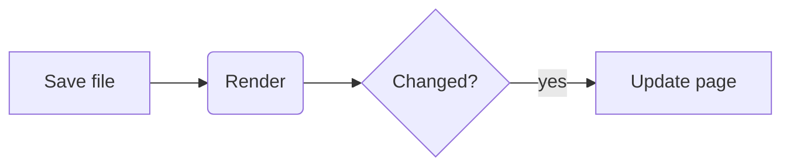

# Release notes

markdown-viewer renders this page like GitHub does, and updates it live
as you edit. **Mermaid**, **math** and **alerts** included.

> [!TIP]
> Press <kbd>t</kbd> to switch theme and <kbd>o</kbd> for the contents.

## Pipeline



## Scoring

The score for each release is $s = \frac{1}{n}\sum_{i=1}^{n} w_i x_i$.

```rust
fn score(weights: &[f64], xs: &[f64]) -> f64 {
    weights.iter().zip(xs).map(|(w, x)| w * x).sum::<f64>() / xs.len() as f64
}
```

## Checklist

- [x] Live reload
- [x] Diagrams and math
- [ ] Ship it
