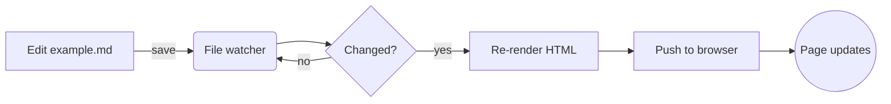
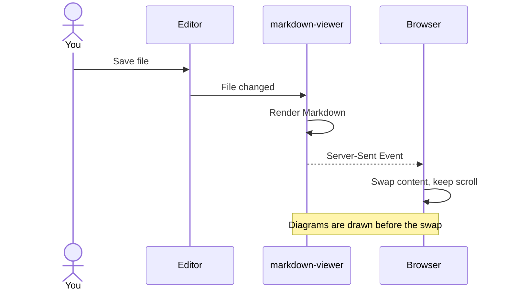
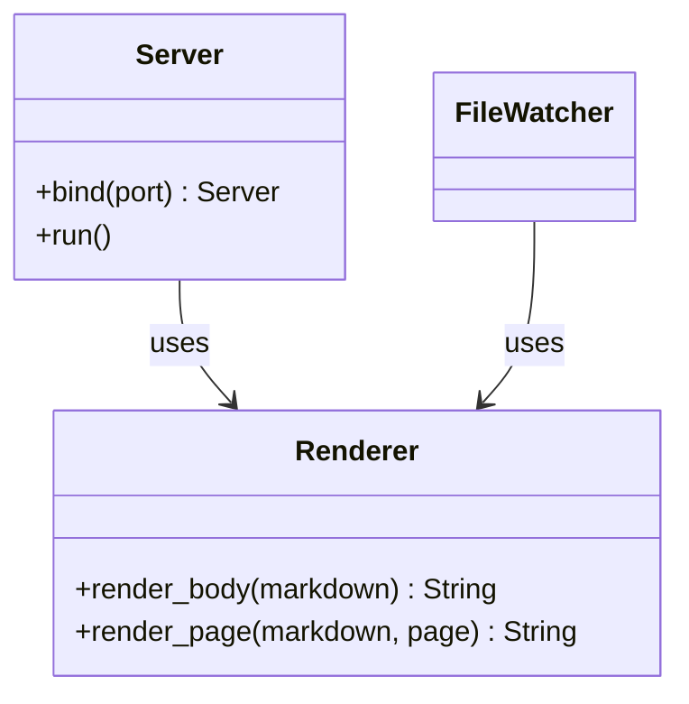
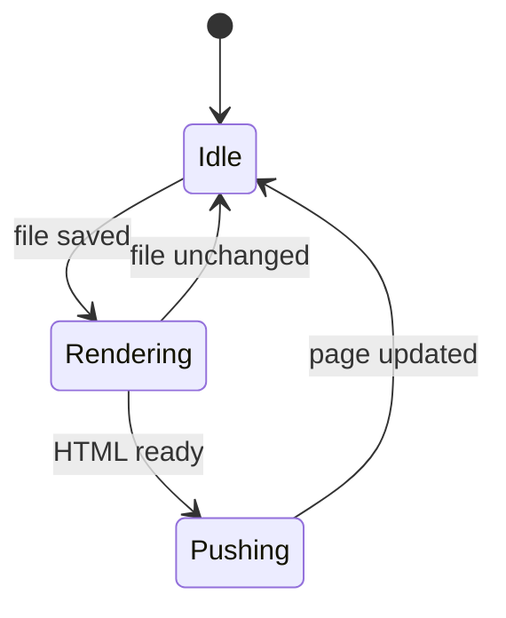
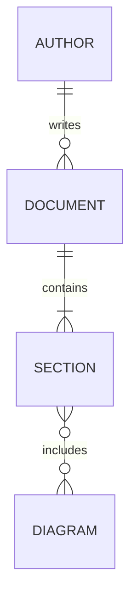
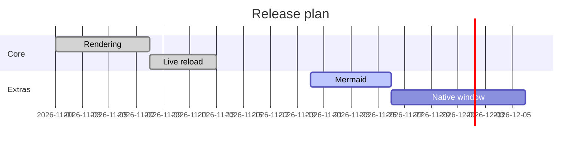
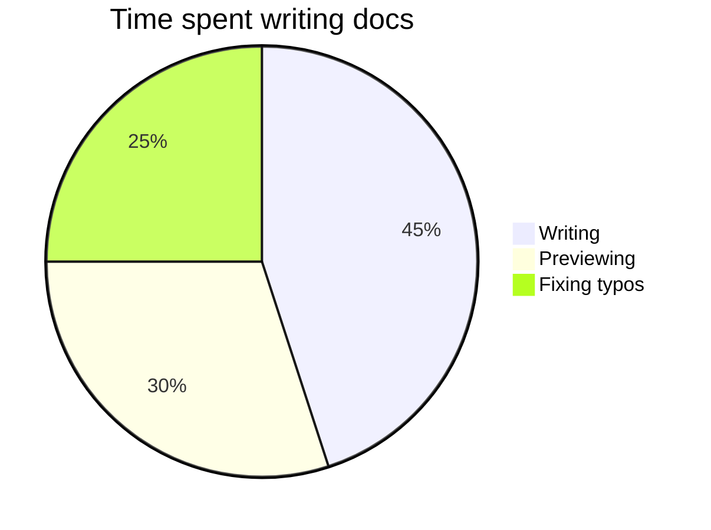
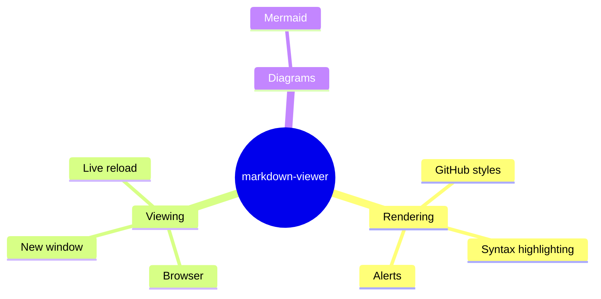
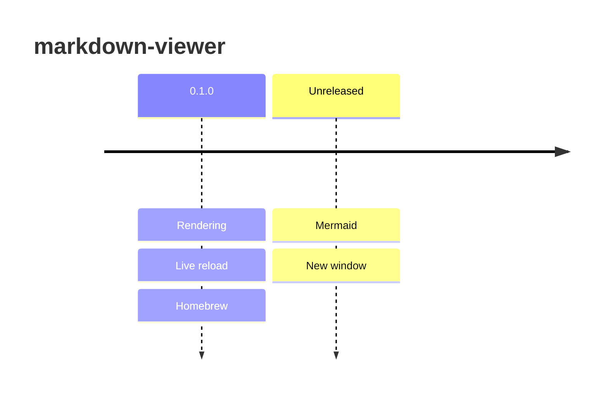

<p align="center"></p>

# markdown-viewer feature tour

A tour of everything markdown-viewer renders. Open it with:

```sh
markdown-viewer --watch examples/example.md
```

**Contents:** [Text](#text) · [Headings](#headings) · [Links](#links) ·
[Images](#images) · [Lists](#lists) · [Tables](#tables) · [Code](#code) ·
[Quotes and alerts](#quotes-and-alerts) · [Footnotes](#footnotes) ·
[Emoji](#emoji) · [Raw HTML](#raw-html) · [Math](#math) ·
[Mermaid diagrams](#mermaid-diagrams)

---

## Text

Plain paragraph text wraps
across source lines into one paragraph.

**Bold**, *italic*, ***bold italic***, ~~strikethrough~~, `inline code`,
and **nested *emphasis* with `code`** inside.

End a line with a backslash for a hard line break\
like this, or with two trailing spaces.  
Like this.

Escaped characters stay literal: \*not italic\*, \`not code\`, \# not a heading.

## Headings

# Heading level 1
## Heading level 2
### Heading level 3
#### Heading level 4
##### Heading level 5
###### Heading level 6

Setext heading level 1
======================

Setext heading level 2
----------------------

Every heading gets an anchor; hover one to see the link icon.

## Links

- Inline link: [GitHub](https://github.com "GitHub's home page")
- Reference link: [CommonMark spec][spec]
- Autolinks: https://github.github.com/gfm/ and <https://example.com>
- Email autolink: someone@example.com
- Link to a heading on this page: [jump to Mermaid](#mermaid-diagrams)
- Relative link to another Markdown file: [other.md](other.md)

[spec]: https://spec.commonmark.org/ "CommonMark"

## Images

A relative image (served from the Markdown file's folder):


A linked image:

[](https://github.com/mdellavo/markdown-viewer)

## Lists

Unordered, with nesting:

- Fruit
  - Apples
    - Granny Smith
    - Honeycrisp
  - Oranges
- Vegetables
* A different bullet marker
+ And another

Ordered, starting at 3:

3. Third
4. Fourth
5. Fifth

Mixed nesting:

1. Install
   - with Homebrew
   - or with Cargo
2. Run
   ```sh
   markdown-viewer README.md
   ```
3. Edit and watch it reload

Task list:

- [x] Render GitHub Flavored Markdown
- [x] Live reload
- [x] Mermaid diagrams
- [x] Math
- [ ] Native window
  - [x] Nested tasks work too

## Tables

| Feature | Supported | Notes |
|:--------|:---------:|------:|
| Tables | ✅ | left, center and right alignment |
| **Inline** *formatting* | ✅ | `code`, [links](#links), ~~strike~~ |
| Escaped \| pipe | ✅ | use `\|` |

## Code

Fenced code with syntax highlighting:

```rust
use std::collections::HashMap;

/// Count words in a string.
fn word_counts(text: &str) -> HashMap<&str, usize> {
    let mut counts = HashMap::new();
    for word in text.split_whitespace() {
        *counts.entry(word).or_insert(0) += 1;
    }
    counts
}
```

```python
from dataclasses import dataclass

@dataclass
class Point:
    x: float
    y: float

    def norm(self) -> float:
        return (self.x ** 2 + self.y ** 2) ** 0.5
```

```javascript
const greet = (name = "world") => `Hello, ${name}!`;
console.log(greet());
```

```json
{ "name": "markdown-viewer", "features": ["gfm", "mermaid"], "offline": true }
```

```diff
- old line
+ new line
  unchanged line
```

A fence with no language:

```
plain preformatted text
    keeps its spacing
```

An indented code block:

    four spaces of indent
    makes a code block

## Quotes and alerts

> A blockquote.
>
> > A nested blockquote.
>
> Back to the outer quote, with **formatting** and a list:
> - one
> - two

GitHub alerts:

> [!NOTE]
> Useful information that users should know, even when skimming content.

> [!TIP]
> Helpful advice for doing things better or more easily.

> [!IMPORTANT]
> Key information users need to know to achieve their goal.

> [!WARNING]
> Urgent info that needs immediate user attention to avoid problems.

> [!CAUTION]
> Advises about risks or negative outcomes of certain actions.

## Footnotes

Footnotes are collected at the bottom of the page.[^first] They can have
names and longer content.[^long]

[^first]: The first footnote.
[^long]: A footnote with **formatting** and a [link](https://example.com).

## Emoji

Shortcodes: :rocket: :tada: :white_check_mark: :warning: :heart: :+1:

Unicode emoji work as-is: 🚀 🎉

## Raw HTML

<details>
<summary>Click to expand a <code>&lt;details&gt;</code> block</summary>

Hidden content, with **Markdown** inside (note the blank line after
`<summary>`).

</details>

Press <kbd>Ctrl</kbd> + <kbd>C</kbd> to stop the server.

H<sub>2</sub>O and E = mc<sup>2</sup>.

<!-- HTML comments are not rendered. -->

<script>document.body.innerHTML = "scripts in Markdown are blocked";</script>

The `<script>` above is blocked by the page's Content-Security-Policy, so
this page is still here.

---

## Math

Inline math with dollars: the Pythagorean theorem is $a^2 + b^2 = c^2$, and
Euler's identity is $e^{i\pi} + 1 = 0$. Dollar amounts like $5 or $10 are left
alone.

Inline math with backticks, for when the TeX would confuse Markdown:
$`\sqrt{x_1^2 + x_2^2}`$.

A display equation on its own lines:

$$
\int_{-\infty}^{\infty} e^{-x^2}\,dx = \sqrt{\pi}
$$

A `math` code block:

```math
\begin{aligned}
\nabla \cdot \mathbf{E} &= \frac{\rho}{\varepsilon_0} \\
\nabla \times \mathbf{B} - \frac{1}{c^2}\frac{\partial \mathbf{E}}{\partial t} &= \mu_0 \mathbf{J}
\end{aligned}
```

Matrices, sums and cases:

$$
\mathbf{A} = \begin{pmatrix} 1 & 2 \\ 3 & 4 \end{pmatrix}, \qquad
\sum_{k=1}^{n} k = \frac{n(n+1)}{2}, \qquad
|x| = \begin{cases} x & x \ge 0 \\ -x & x < 0 \end{cases}
$$

Invalid TeX is shown in red instead of breaking the page: $\frac{1}{$.

---

## Mermaid diagrams

Code blocks tagged `mermaid` are drawn as diagrams.

### Flowchart



### Sequence diagram



### Class diagram



### State diagram



### Entity relationship diagram



### Gantt chart



### Pie chart



### Git graph


### Mindmap



### Timeline


