<p align="center"></p>

# markdown-viewer feature tour

A tour of everything markdown-viewer renders. Open it with:

```sh
markdown-viewer --watch examples/example.md
```

In the viewer, press <kbd>?</kbd> for keyboard shortcuts, <kbd>o</kbd> for the
contents, and <kbd>t</kbd> to switch between auto, light and dark.

Two more examples: [slides.md](slides.md) is a deck for presentation mode
(<kbd>s</kbd>), and [vault/Home.md](vault/Home.md) shows Obsidian notes.

A `[TOC]` line makes the table of contents below from the headings. Click
its title to fold it, or a section's arrow to fold just that section.

[TOC]

---

## Text

Plain paragraph text wraps
across source lines into one paragraph.

**Bold**, *italic*, ***bold italic***, ~~strikethrough~~, `inline code`,
and **nested *emphasis* with `code`** inside.

End a line with a backslash for a hard line break\
like this, or with two trailing spaces.  
Like this.

Escaped characters stay literal: \*not italic\*, \`not code\`, \# not a heading.

Colours in inline code get a swatch, as on GitHub: `#0969da`,
`rgb(207, 34, 46)` and `hsl(137 55% 41%)`.

Beyond GitHub: E = mc^2^ and H~2~O, with `^superscript^` and
`~subscript~` (on GitHub, single tildes strike through). Abbreviations
defined at the end of the file, such as HTML and GFM, show their meaning on
hover.

## Headings

# Heading level 1
## Heading level 2
### Heading level 3
#### Heading level 4
##### Heading level 5
###### Heading level 6

Setext heading level 1
======================

Setext heading level 2
----------------------

Every heading gets an anchor; hover one to see the link icon.

## Links

- Inline link: [GitHub](https://github.com "GitHub's home page")
- Reference link: [CommonMark spec][spec]
- Autolinks: https://github.github.com/gfm/ and <https://example.com>
- Email autolink: someone@example.com
- Link to a heading on this page: [jump to Mermaid](#mermaid-diagrams)
- Relative link to another Markdown file: [other.md](other.md)
- GitHub references (in a checkout with a GitHub remote): #1, GH-1,
  rust-lang/rust#1 and @github

[spec]: https://spec.commonmark.org/ "CommonMark"

## Images

A relative image (served from the Markdown file's folder):


A linked image:

[](https://github.com/mdellavo/markdown-viewer)

Theme-aware images, as on GitHub: add `#gh-light-mode-only` or
`#gh-dark-mode-only` to the image URL. There are two images below, but only
the one for the current theme is shown (hover it to see which):


Video and audio files, linked like images, become players:


## Lists

Unordered, with nesting:

- Fruit
  - Apples
    - Granny Smith
    - Honeycrisp
  - Oranges
- Vegetables
* A different bullet marker
+ And another

Ordered, starting at 3:

3. Third
4. Fourth
5. Fifth

Mixed nesting:

1. Install
   - with Homebrew
   - or with Cargo
2. Run
   ```sh
   markdown-viewer README.md
   ```
3. Edit and watch it reload

Task list:

- [x] Render GitHub Flavored Markdown
- [x] Live reload
- [x] Mermaid diagrams
- [x] Math
- [ ] Native window
  - [x] Nested tasks work too

Definition list (beyond GitHub):

Markdown
: A plain-text format for writing documents.

markdown-viewer
: Renders Markdown the way GitHub does.
: Updates the page as you save.

## Tables

| Feature | Supported | Notes |
|:--------|:---------:|------:|
| Tables | ✅ | left, center and right alignment |
| **Inline** *formatting* | ✅ | `code`, [links](#links), ~~strike~~ |
| Escaped \| pipe | ✅ | use `\|` |

In the viewer, click a column header to sort. CSV and TSV files are shown
as tables too: [cities.csv](cities.csv).

## Code

Fenced code with syntax highlighting:

```rust
use std::collections::HashMap;

/// Count words in a string.
fn word_counts(text: &str) -> HashMap<&str, usize> {
    let mut counts = HashMap::new();
    for word in text.split_whitespace() {
        *counts.entry(word).or_insert(0) += 1;
    }
    counts
}
```

```python
from dataclasses import dataclass

@dataclass
class Point:
    x: float
    y: float

    def norm(self) -> float:
        return (self.x ** 2 + self.y ** 2) ** 0.5
```

```javascript
const greet = (name = "world") => `Hello, ${name}!`;
console.log(greet());
```

```json
{ "name": "markdown-viewer", "features": ["gfm", "mermaid"], "offline": true }
```

```diff
- old line
+ new line
  unchanged line
```

A fence with no language:

```
plain preformatted text
    keeps its spacing
```

An indented code block:

    four spaces of indent
    makes a code block

A title, highlighted lines and line numbers, set after the language
(GitHub ignores these, so the file still looks right there):

```python title="geometry.py" {3-4} showLineNumbers
import math

def hypotenuse(a: float, b: float) -> float:
    return math.sqrt(a * a + b * b)

print(hypotenuse(3, 4))
```

## Quotes and alerts

> A blockquote.
>
> > A nested blockquote.
>
> Back to the outer quote, with **formatting** and a list:
> - one
> - two

GitHub alerts:

> [!NOTE]
> Useful information that users should know, even when skimming content.

> [!TIP]
> Helpful advice for doing things better or more easily.

> [!IMPORTANT]
> Key information users need to know to achieve their goal.

> [!WARNING]
> Urgent info that needs immediate user attention to avoid problems.

> [!CAUTION]
> Advises about risks or negative outcomes of certain actions.

## Footnotes

Footnotes are collected at the bottom of the page.[^first] They can have
names and longer content.[^long]

[^first]: The first footnote.
[^long]: A footnote with **formatting** and a [link](https://example.com).

## Emoji

Shortcodes: :rocket: :tada: :white_check_mark: :warning: :heart: :+1:

Unicode emoji work as-is: 🚀 🎉

## Raw HTML

<details>
<summary>Click to expand a <code>&lt;details&gt;</code> block</summary>

Hidden content, with **Markdown** inside (note the blank line after
`<summary>`).

</details>

Press <kbd>Ctrl</kbd> + <kbd>C</kbd> to stop the server.

H<sub>2</sub>O and E = mc<sup>2</sup>.

<!-- HTML comments are not rendered. -->

<script>document.body.innerHTML = "scripts in Markdown are blocked";</script>

The `<script>` above is blocked by the page's Content-Security-Policy, so
this page is still here.

---

## Math

Inline math with dollars: the Pythagorean theorem is $a^2 + b^2 = c^2$, and
Euler's identity is $e^{i\pi} + 1 = 0$. Dollar amounts like $5 or $10 are left
alone.

Inline math with backticks, for when the TeX would confuse Markdown:
$`\sqrt{x_1^2 + x_2^2}`$.

A display equation on its own lines:

$$
\int_{-\infty}^{\infty} e^{-x^2}\,dx = \sqrt{\pi}
$$

A `math` code block:

```math
\begin{aligned}
\nabla \cdot \mathbf{E} &= \frac{\rho}{\varepsilon_0} \\
\nabla \times \mathbf{B} - \frac{1}{c^2}\frac{\partial \mathbf{E}}{\partial t} &= \mu_0 \mathbf{J}
\end{aligned}
```

Matrices, sums and cases:

$$
\mathbf{A} = \begin{pmatrix} 1 & 2 \\ 3 & 4 \end{pmatrix}, \qquad
\sum_{k=1}^{n} k = \frac{n(n+1)}{2}, \qquad
|x| = \begin{cases} x & x \ge 0 \\ -x & x < 0 \end{cases}
$$

Invalid TeX is shown in red instead of breaking the page: $\frac{1}{$.

[AsciiMath](https://asciimath.org), if you'd rather not write TeX
(`asciimath` blocks, one equation per line):

```asciimath
sum_(i=1)^n i^2 = (n(n+1)(2n+1))/6
x = (-b +- sqrt(b^2 - 4ac))/(2a)
[[a, b], [c, d]] [[x], [y]] = [[ax + by], [cx + dy]]
```

---

## Mermaid diagrams

Code blocks tagged `mermaid` are drawn as diagrams.

### Flowchart

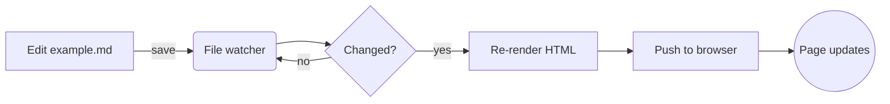

### Sequence diagram

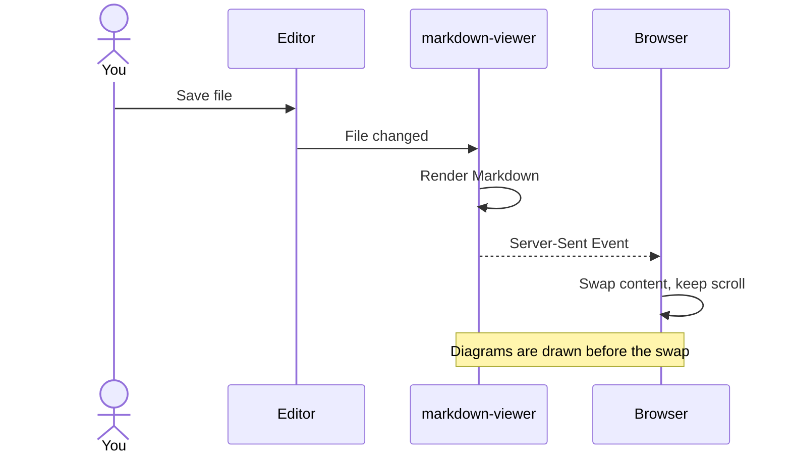

### Class diagram

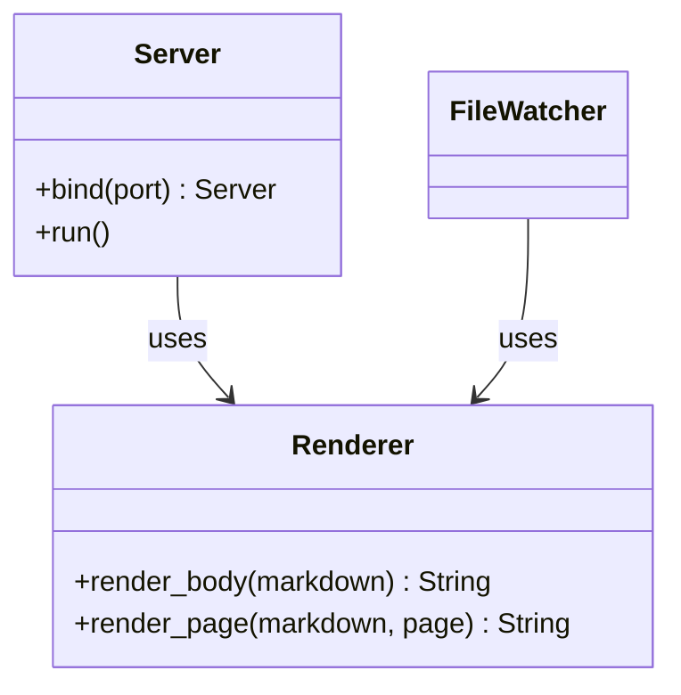

### State diagram

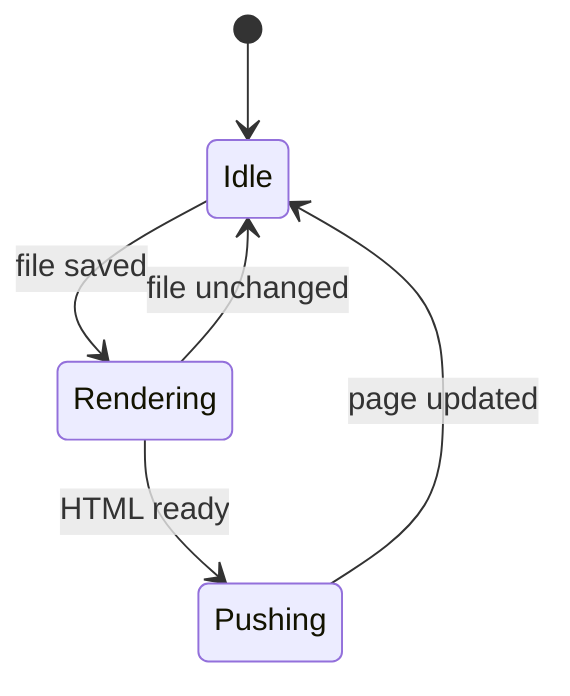

### Entity relationship diagram

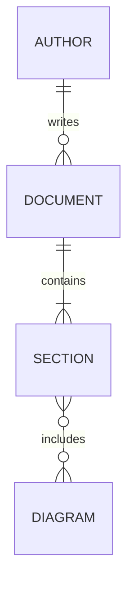

### Gantt chart

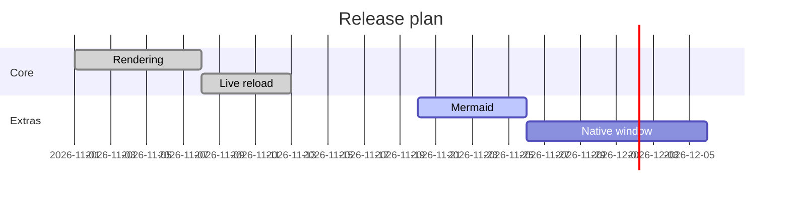

### Pie chart

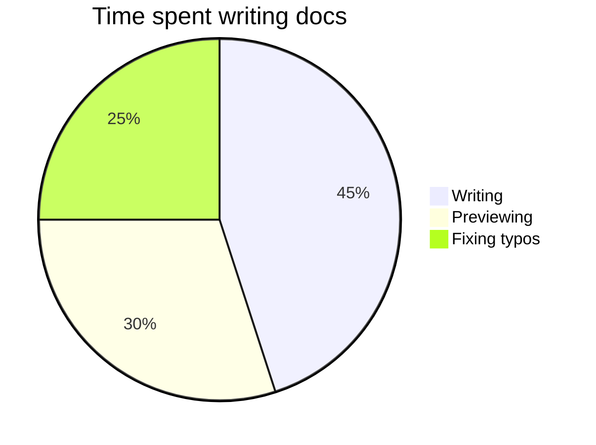

### Git graph

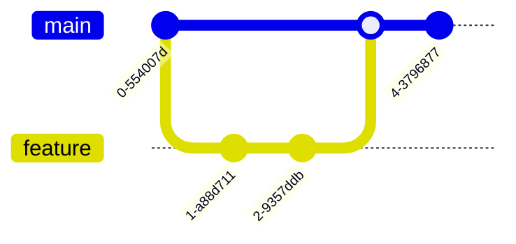

### Mindmap

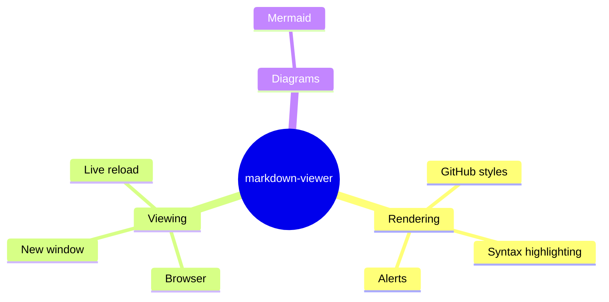

### Timeline

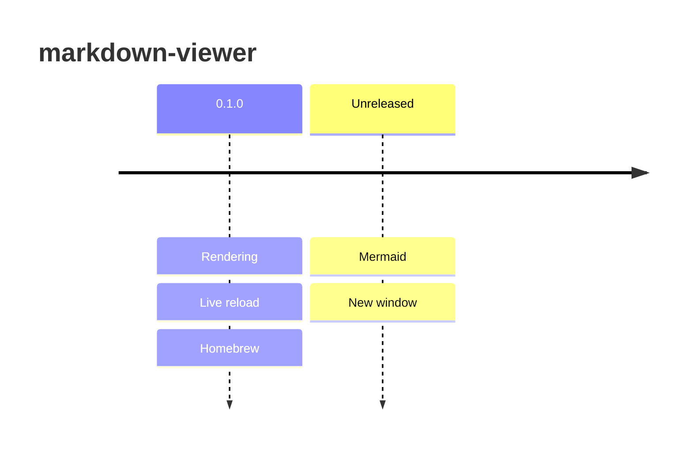

## Maps and 3D models

As on GitHub, `geojson` and `topojson` blocks are drawn as maps, and `stl`
blocks as 3D models. Maps are drawn without map tiles (they'd need the
web): shapes over a latitude and longitude grid, with each feature's
properties on hover. Drag a model to turn it.

```geojson
{
  "type": "FeatureCollection",
  "features": [
    { "type": "Feature", "properties": { "name": "Boston", "marker-color": "#cf222e" },
      "geometry": { "type": "Point", "coordinates": [-71.06, 42.36] } },
    { "type": "Feature", "properties": { "name": "Providence" },
      "geometry": { "type": "Point", "coordinates": [-71.41, 41.82] } },
    { "type": "Feature", "properties": { "name": "Route" },
      "geometry": { "type": "LineString", "coordinates": [[-71.06, 42.36], [-71.25, 42.05], [-71.41, 41.82]] } },
    { "type": "Feature", "properties": { "name": "Area", "fill": "#2da44e", "stroke": "#2da44e" },
      "geometry": { "type": "Polygon", "coordinates": [[[-71.8, 42.0], [-71.5, 42.0], [-71.5, 42.25], [-71.8, 42.25], [-71.8, 42.0]]] } }
  ]
}
```

```topojson
{
  "type": "Topology",
  "transform": { "scale": [0.001, 0.001], "translate": [-72, 41] },
  "objects": {
    "shapes": { "type": "GeometryCollection", "geometries": [
      { "type": "Polygon", "arcs": [[0, 1]], "properties": { "name": "West" } },
      { "type": "Polygon", "arcs": [[-2, 2]], "properties": { "name": "East" } }
    ] }
  },
  "arcs": [
    [[500, 0], [-500, 0], [0, 1000], [500, 0]],
    [[500, 1000], [0, -1000]],
    [[500, 1000], [500, 0], [0, -1000], [-500, 0]]
  ]
}
```

```stl
solid pyramid
facet normal 0 0 -1
  outer loop
    vertex 0 0 0
    vertex 1 1 0
    vertex 1 0 0
  endloop
endfacet
facet normal 0 0 -1
  outer loop
    vertex 0 0 0
    vertex 0 1 0
    vertex 1 1 0
  endloop
endfacet
facet normal 0 -0.89 0.45
  outer loop
    vertex 0 0 0
    vertex 1 0 0
    vertex 0.5 0.5 1
  endloop
endfacet
facet normal 0.89 0 0.45
  outer loop
    vertex 1 0 0
    vertex 1 1 0
    vertex 0.5 0.5 1
  endloop
endfacet
facet normal 0 0.89 0.45
  outer loop
    vertex 1 1 0
    vertex 0 1 0
    vertex 0.5 0.5 1
  endloop
endfacet
facet normal -0.89 0 0.45
  outer loop
    vertex 0 1 0
    vertex 0 0 0
    vertex 0.5 0.5 1
  endloop
endfacet
endsolid pyramid
```

### More map and model formats

GPX tracks, KML placemarks and WKT geometry are drawn on the same kind of
map, and OBJ, PLY and OFF models like STL ones:

```gpx
<?xml version="1.0"?>
<gpx version="1.1" creator="example" xmlns="http://www.topografix.com/GPX/1/1">
  <wpt lat="42.3601" lon="-71.0589"><name>Boston</name></wpt>
  <trk><name>Along the river</name><trkseg>
    <trkpt lat="42.3601" lon="-71.0589"/><trkpt lat="42.3626" lon="-71.0843"/>
    <trkpt lat="42.3736" lon="-71.1097"/><trkpt lat="42.3678" lon="-71.1316"/>
  </trkseg></trk>
</gpx>
```

```kml
<kml xmlns="http://www.opengis.net/kml/2.2"><Document>
  <Placemark><name>Boston Common</name><Polygon><outerBoundaryIs><LinearRing>
    <coordinates>-71.0707,42.3554 -71.0627,42.3570 -71.0639,42.3525 -71.0688,42.3533 -71.0707,42.3554</coordinates>
  </LinearRing></outerBoundaryIs></Polygon></Placemark>
</Document></kml>
```

```wkt
POLYGON ((-71.07 42.35, -71.05 42.35, -71.06 42.37, -71.07 42.35))
POINT (-71.06 42.36)
```

```obj
# A cube: eight corners, six square faces
v -1 -1 -1
v 1 -1 -1
v 1 1 -1
v -1 1 -1
v -1 -1 1
v 1 -1 1
v 1 1 1
v -1 1 1
f 1 2 3 4
f 5 8 7 6
f 1 5 6 2
f 2 6 7 3
f 3 7 8 4
f 4 8 5 1
```

Model and map files can be shown like images, binary STL too:


glTF (`.gltf`, `.glb`, or a `gltf` block) and 3MF models:


## More diagrams

ASCII art with [Svgbob](https://github.com/ivanceras/svgbob) (`bob`):

```bob
  .--------.      .--------.
  | Editor |----->| Viewer |
  '--------'      '--------'
       |               ^
       v               |
  +--------+           |
  |  File  |-----------'
  +--------+
```

[Pikchr](https://pikchr.org), the diagram language from SQLite:

```pikchr
arrow right 200% "Markdown" "Source"
box rad 10px "markdown-" "viewer" fit
arrow right 200% "HTML" "and SVG"
```

[WaveDrom](https://wavedrom.com) timing diagrams:

```wavedrom
{ signal: [
  { name: "clk",  wave: "p.......|.." },
  { name: "addr", wave: "x.3.x...|4x", data: ["A1", "A2"] },
  { name: "data", wave: "x...5.x.|.6", data: ["D1", "D2"] },
  { name: "ack",  wave: "0....1.0|.1" }
]}
```

Graphviz (`dot`), PlantUML (`plantuml`) and D2 (`d2`) blocks are drawn by
the program when it's installed; otherwise they say what to install:

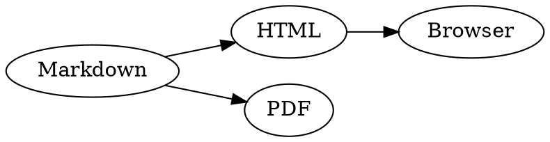

A QR code (`qr`) for the text in the block:

```qr
https://github.com/mdellavo/markdown-viewer
```

## Charts, music and chemistry

[Vega-Lite](https://vega.github.io/vega-lite/) charts:

```vega-lite
{
  "$schema": "https://vega.github.io/schema/vega-lite/v6.json",
  "description": "Rainfall by month",
  "data": { "values": [
    { "month": "Jan", "mm": 92 }, { "month": "Feb", "mm": 84 }, { "month": "Mar", "mm": 109 },
    { "month": "Apr", "mm": 94 }, { "month": "May", "mm": 86 }, { "month": "Jun", "mm": 93 }
  ] },
  "mark": "bar",
  "encoding": {
    "x": { "field": "month", "type": "ordinal", "sort": null },
    "y": { "field": "mm", "type": "quantitative", "title": "Rainfall (mm)" }
  }
}
```

Sheet music in [ABC notation](https://abcnotation.com) (`abc`):

```abc
X:1
T:Twinkle, Twinkle
M:4/4
L:1/4
K:C
CCGG|AAG2|FFEE|DDC2|
```

Molecules from [SMILES](https://en.wikipedia.org/wiki/Simplified_Molecular_Input_Line_Entry_System) (`smiles`), here caffeine:

```smiles
CN1C=NC2=C1C(=O)N(C(=O)N2C)C
```

Molecules from their files: a flat molfile (`mol`, `sdf`) is drawn as a
structure, and 3D coordinates (molfiles, `xyz`, `pdb`) as balls and sticks
that turn when dragged:


```xyz
5
methane
C   0.000   0.000   0.000
H   0.629   0.629   0.629
H  -0.629  -0.629   0.629
H  -0.629   0.629  -0.629
H   0.629  -0.629  -0.629
```

## Calendars

An iCalendar file (`.ics`, or an `ics` block) as a list of events:

```ics
BEGIN:VCALENDAR
VERSION:2.0
X-WR-CALNAME:Release planning
BEGIN:VEVENT
SUMMARY:Feature freeze
DTSTART;VALUE=DATE:20261201
END:VEVENT
BEGIN:VEVENT
SUMMARY:Stand-up
DTSTART;TZID=America/New_York:20261202T093000
DTEND;TZID=America/New_York:20261202T094500
RRULE:FREQ=WEEKLY;BYDAY=MO,WE,FR
LOCATION:Video call
END:VEVENT
BEGIN:VEVENT
SUMMARY:Release
DTSTART:20261210T170000Z
DTEND:20261210T180000Z
DESCRIPTION:Tag\, build and publish.
END:VEVENT
END:VCALENDAR
```

## Chess

A position in FEN (`fen`):

```fen
r1bqkb1r/pppp1ppp/2n2n2/4p2Q/2B1P3/8/PPPP1PPP/RNB1K1NR w KQkq - 4 4
```

A game in PGN (`pgn`), shown at its final position:

```pgn
[White "Scholar"]
[Black "Victim"]
[Result "1-0"]

1. e4 e5 2. Qh5 Nc6 3. Bc4 Nf6 4. Qxf7# 1-0
```

*[HTML]: HyperText Markup Language
*[GFM]: GitHub Flavored Markdown
