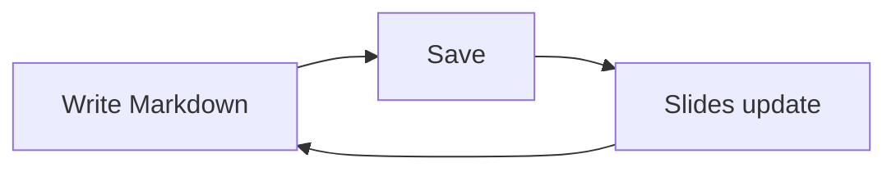

<p align="center"></p>

# Slides with markdown-viewer

A deck is just a Markdown file.

```sh
markdown-viewer --watch examples/slides.md
```

Press <kbd>s</kbd> to present, <kbd>Esc</kbd> to stop.

---

## Splitting into slides

- Each `---` rule starts a new slide.
- No rules? Every `#` and `##` heading starts one instead.
- Front matter is metadata, not a slide.

> [!TIP]
> Presentation starts at the slide you were reading.

---

## Moving around

| Keys | Action |
| --- | --- |
| <kbd>→</kbd> <kbd>↓</kbd> <kbd>Space</kbd> <kbd>n</kbd> | Next slide |
| <kbd>←</kbd> <kbd>↑</kbd> <kbd>Backspace</kbd> <kbd>p</kbd> | Previous slide |
| <kbd>Home</kbd> / <kbd>End</kbd> | First / last slide |
| <kbd>t</kbd> | Switch theme |
| <kbd>Esc</kbd> <kbd>s</kbd> <kbd>q</kbd> | Stop presenting |

Or click: the right of the screen goes forward, the left third goes back.

---

## Code

```rust title="main.rs" {2}
fn main() {
    println!("Hello, slides!");
}
```

Highlighting, titles and line marks work as they do on the page.

---

## Diagrams



---

## Math

The quadratic formula:

$$
x = \frac{-b \pm \sqrt{b^2 - 4ac}}{2a}
$$

Inline math works too: $e^{i\pi} + 1 = 0$.

---

## Live while presenting

With `--watch`, edit this file in your editor and save: the slide on screen
updates without leaving the presentation.

- [x] Write the deck
- [ ] Rehearse
- [ ] Present

---

# Thanks!

Questions?
