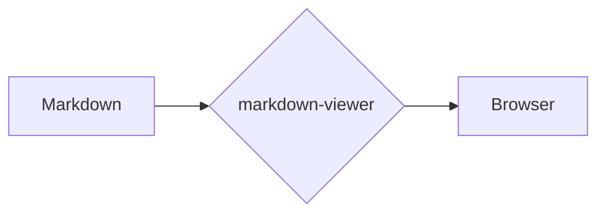

# GitHub Flavored Markdown sample

Text with **bold**, *italic*, ~~strikethrough~~, `code`, and a link to
https://github.com plus an emoji :rocket:.

## Lists

- [x] task done
- [ ] task open
  1. nested ordered
  2. second

## Table

| Left | Center | Right |
|:-----|:------:|------:|
| a    |   b    |     c |

## Code

```rust
fn main() {
    println!("hello");
}
```

## Alerts

> [!NOTE]
> Useful information.

> [!WARNING]
> Be careful.

## Footnote

Here is a footnote reference.[^1]

[^1]: The footnote.

## Raw HTML

<p align="center"></p>

## Mermaid


